<table align="center" border="0" cellspacing="0" cellpadding="0">
  <tr>
    <td valign="middle"></td>
    <td valign="middle"><h1 style="margin:0;border-bottom:none;padding:0;">&nbsp;Vue Print Designer</h1></td>
  </tr>
</table>

<p align="center">
  
</p>

<p align="center">
  <b>Visueller Druckdesigner &nbsp;&middot;&nbsp; Etiketten / Belege / Formulare — alles abgedeckt</b><br/>
  <sub>Vorlagen und Variablen &nbsp;&middot;&nbsp; Stilles Drucken und Cloud-Druck in einem &nbsp;&middot;&nbsp; Zero-Dependency-Integration für jeden Stack</sub>
</p>

<p align="center">
  <a href="https://gitee.com/theGreatOldFive/vue-print-designer/stargazers"></a>
  <a href="https://gitee.com/theGreatOldFive/vue-print-designer/members"></a>
  <a href="https://github.com/0ldFive/Vue-Print-Designer/stargazers"></a>
  <a href="https://github.com/0ldFive/Vue-Print-Designer/network/members"></a>
  <br/>
  <a href="https://www.npmjs.com/package/vue-print-designer"></a>
  <a href="https://www.npmjs.com/package/vue-print-designer"></a>
  <a href="https://github.com/0ldFive/Vue-Print-Designer/blob/master/LICENSE"></a>
  <a target="_blank" href="https://qm.qq.com/cgi-bin/qm/qr?k=n-5GjVjM51eH2XvL71r-R8-72r1A2z0V&jump_from=webapi&authKey=zB6r+Q2/Q2/Q2/Q2/Q2/Q2/Q2/Q2/Q2/Q2/Q2/Q2/Q2/Q2/Q2/Q2/Q2/Q2"></a>
</p>

<p align="center">
  <a href="https://0ldfive.github.io/Vue-Print-Designer/"><b>Live-Demo</b></a>
  &nbsp;&middot;&nbsp;
  <a href="https://github.com/0ldFive/Vue-Print-Designer/blob/master/docs/en/guide/web-components-guide.md"><b>Dokumentation</b></a>
  &nbsp;&middot;&nbsp;
  <a href="https://printdot.cc/de/client"><b>Client herunterladen</b></a>
  &nbsp;&middot;&nbsp;
  <a href="https://github.com/0ldFive/vue-designer-sample"><b>Integrationsbeispiel</b></a>
</p>

<p align="center">
  <a href="https://github.com/0ldFive/Vue-Print-Designer/blob/master/README.zh-CN.md">简体中文</a>
  &nbsp;&middot;&nbsp;
  <a href="https://github.com/0ldFive/Vue-Print-Designer/blob/master/README.md">English</a>
  &nbsp;&middot;&nbsp;
  <a href="https://github.com/0ldFive/Vue-Print-Designer/blob/master/README.zh-TW.md">繁體中文</a>
  &nbsp;&middot;&nbsp;
  <a href="https://github.com/0ldFive/Vue-Print-Designer/blob/master/README.ja.md">日本語</a>
  &nbsp;&middot;&nbsp;
  <a href="https://github.com/0ldFive/Vue-Print-Designer/blob/master/README.ko.md">한국어</a>
  &nbsp;&middot;&nbsp;
  <a href="https://github.com/0ldFive/Vue-Print-Designer/blob/master/README.de.md">Deutsch</a>
</p>

<p align="center">
  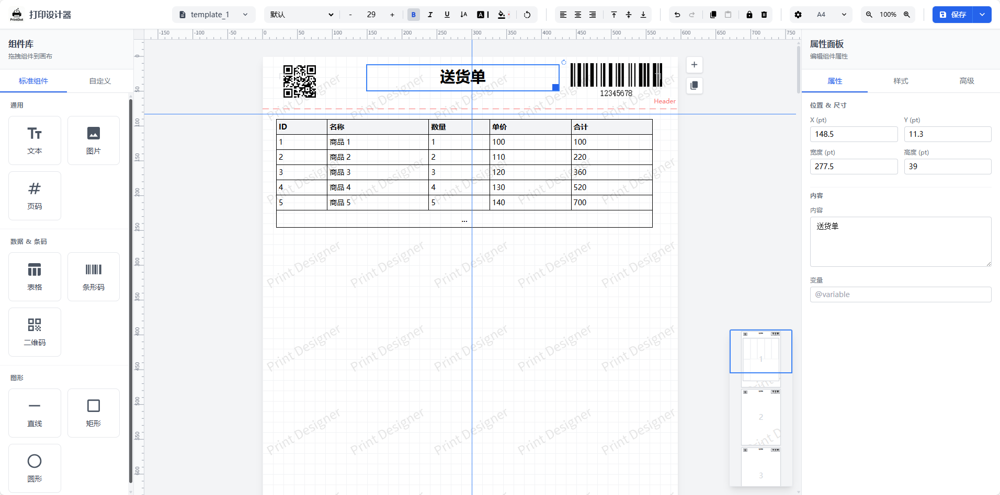
</p>

<p align="center"><sub>Hauptansicht des Designers &nbsp;&middot;&nbsp; Canvas / Eigenschaftenpanel / Ebenenpanel</sub></p>

<table width="100%">
  <tr>
    <td align="center" width="20%"><b>Erstes Laden −65%</b></td>
    <td align="center" width="20%"><b>ES-Bundle 300 KB</b></td>
    <td align="center" width="20%"><b>Rendering 80 ms</b></td>
    <td align="center" width="20%"><b>6 Sprachen integriert</b></td>
    <td align="center" width="20%"><b>4 Befehlssätze</b></td>
  </tr>
  <tr>
    <td align="center" valign="top"><sub>6 schwere Fremdpakete entfernt, schnelleres erstes Laden</sub></td>
    <td align="center" valign="top"><sub>Als Web Components gebaut, geringere Integrationskosten</sub></td>
    <td align="center" valign="top"><sub>Eigene Rendering-Engine, rund 73 % schneller pro Seite</sub></td>
    <td align="center" valign="top"><sub>Automatisch aus dem Browser erkannt oder per API gesetzt</sub></td>
    <td align="center" valign="top"><sub>Unterstützt TSPL / ZPL / ESC-POS / CPCL</sub></td>
  </tr>
</table>

<p align="center"><sub>Drag &amp; Drop &nbsp;→&nbsp; Variablen binden &nbsp;→&nbsp; Vorschau &nbsp;→&nbsp; Ausgabe an Browser / Client / Etikettendrucker</sub></p>

---

## Kernfunktionen

<p align="center"><b>KI-Assistent · Vorlagen in natürlicher Sprache erstellen und bearbeiten</b><br/><sub>Integriertes Chat-Panel für natürliche Sprache: Aus einer Beschreibung entstehen Vorlagen für Rechnungen, Lieferscheine und Frachtbriefe, mit mehrstufigen Änderungen und Bildreferenzen. Ergebnisse erscheinen zuerst als Änderungsvorschau und lassen sich nach der Bestätigung mit einem Klick auf die Canvas übernehmen. Unterstützt OpenAI-kompatible Endpunkte einschließlich selbst gehosteter oder externer Modelldienste, mit mehreren Modellprofilen und erweiterten Sampling-Parametern.</sub></p>

<table width="100%">
  <tr>
    <td align="center" width="33%"><b>Visuelles Design</b></td>
    <td align="center" width="34%"><b>Intelligente Seitenumbrüche</b></td>
    <td align="center" width="33%"><b>Frameworkübergreifend</b></td>
  </tr>
  <tr>
    <td align="center" valign="top"><sub>Drag-and-Drop-Layout mit Linealen, Rastern und Ausrichtungshilfen für Text, Bilder, Tabellen, Barcodes, QR-Codes und Formen — keine geschätzten Elementpositionen mehr.</sub></td>
    <td align="center" valign="top"><sub>Lange Tabellen werden automatisch umbrochen, Kopf- und Fußzeilen wiederholt — ohne manuelle Logik, WYSIWYG.</sub></td>
    <td align="center" valign="top"><sub>Auf Web Components basierend, ohne Abhängigkeiten für Vue / React / Angular / natives HTML, inklusive Vue-2-Unterstützung.</sub></td>
  </tr>
  <tr>
    <td align="center" width="33%"><b>Enterprise-tauglich</b></td>
    <td align="center" width="34%"><b>Drucken &amp; Etiketten</b></td>
    <td align="center" width="33%"><b>Internationalisierung</b></td>
  </tr>
  <tr>
    <td align="center" valign="top"><sub>Eigene Papierformate, API-Datenanbindung, Vorlagenimport/-export sowie Steuerung von Drucker / Exemplaren / Duplex / DPI.</sub></td>
    <td align="center" valign="top"><sub>Browserdruck, PDF- / Bildexport, stilles Drucken / Cloud-Druck sowie native Etikettenbefehle als RAW über die Systemdruckwarteschlange — Barcodes und QR-Codes bleiben vektorscharf.</sub></td>
    <td align="center" valign="top"><sub>Chinesisch vereinfacht / traditionell, Englisch, Japanisch, Koreanisch und Deutsch — automatisch aus dem Browser erkannt oder per API gesetzt.</sub></td>
  </tr>
</table>

## UI-Vorschau

<table width="100%">
  <tr>
    <td align="center" width="50%">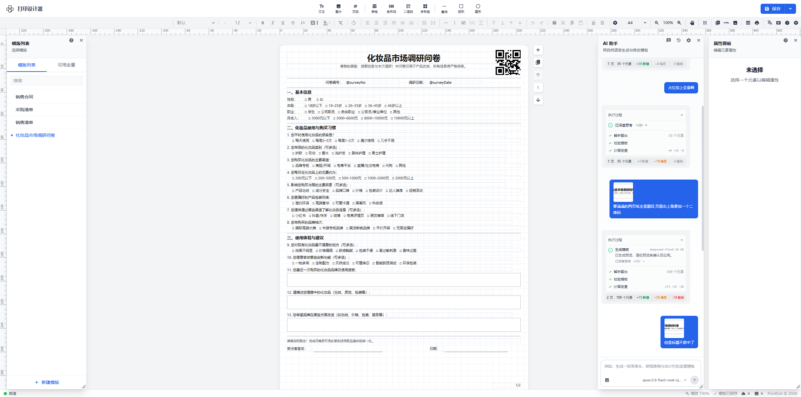</td>
    <td align="center" width="50%">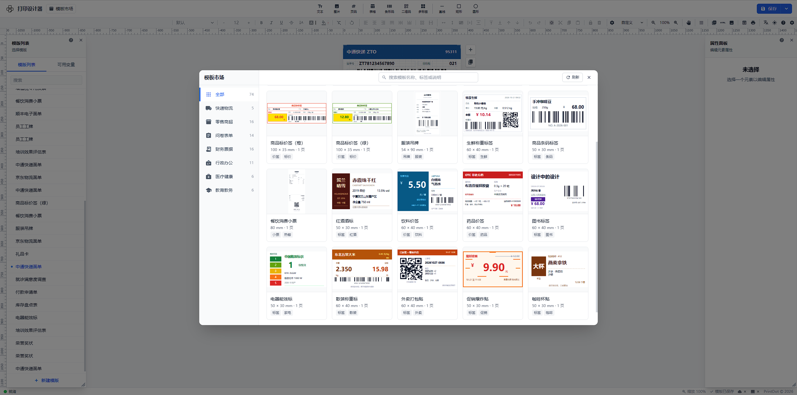</td>
  </tr>
  <tr>
    <td align="center"><b>KI-Assistent &#183; Vorlagenerstellung in natürlicher Sprache</b></td>
    <td align="center"><b>Vorlagenmarkt</b></td>
  </tr>
</table>

<table width="100%">
  <tr>
    <td align="center" width="25%">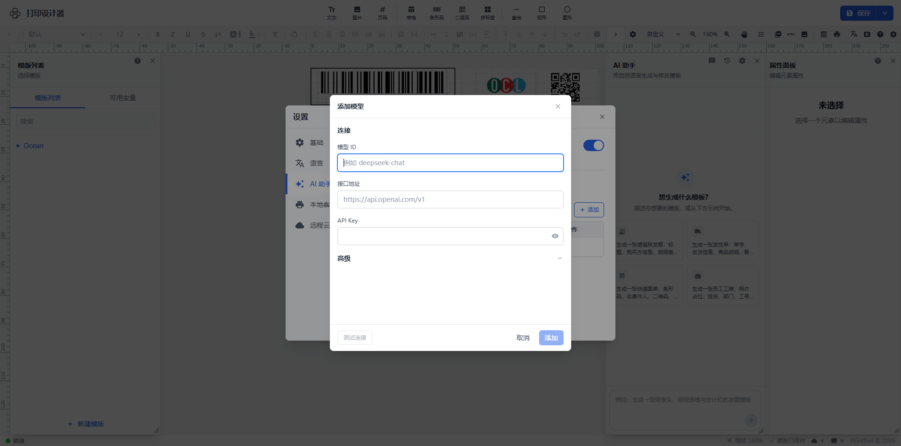</td>
    <td align="center" width="25%">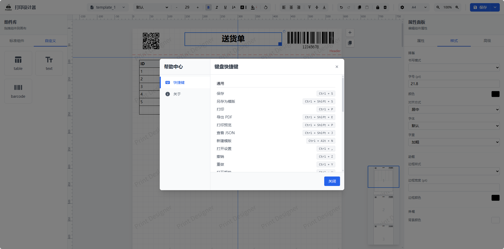</td>
    <td align="center" width="25%">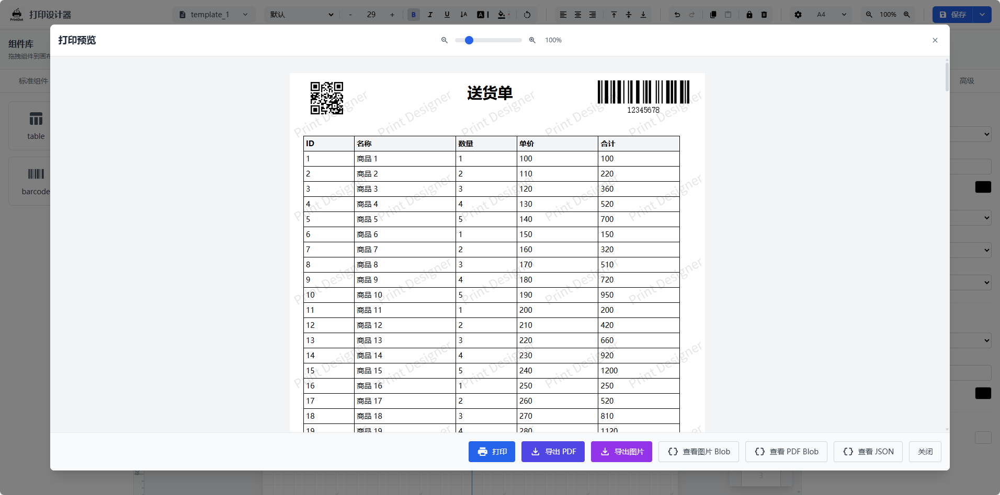</td>
    <td align="center" width="25%"></td>
  </tr>
  <tr>
    <td align="center"><b>KI-Assistent &#183; Einrichtung des Modell-Endpunkts</b></td>
    <td align="center"><b>Tastenkürzel-Übersicht</b></td>
    <td align="center"><b>Druckvorschau</b></td>
    <td align="center"><b>Community &middot; QQ-Gruppe 1038069636</b></td>
  </tr>
</table>

## Drucken &amp; Exportieren

<table width="100%" style="width: 100%;">
  <tr>
    <td align="center" width="25%" style="width: 25%;"><b>Browserdruck</b></td>
    <td align="center" width="25%" style="width: 25%;"><b>Export</b></td>
    <td align="center" width="25%" style="width: 25%;"><b>Stilles Drucken / Cloud-Druck</b></td>
    <td align="center" width="25%" style="width: 25%;"><b>RAW-Etikettausgabe</b></td>
  </tr>
  <tr>
    <td align="center" valign="top"><sub>Native Vorschau und Druck, mit Steuerung von Drucker / Exemplaren / Duplex / DPI</sub></td>
    <td align="center" valign="top"><sub>PDF, Bilder (zusammenführen / teilen), HTML und Blob mit eigenen Dateinamen erzeugen</sub></td>
    <td align="center" valign="top"><sub>Stilles Drucken ohne Dialoge, Cloud-Druck mit entfernten Aufträgen, ausgeführt vom lokalen Client</sub></td>
    <td align="center" valign="top"><sub>Vorlagen zu nativen Befehlen, als RAW über die Systemwarteschlange, Stapel und Endlospapier</sub></td>
  </tr>
</table>

## Begleitender Druckclient (PrintDot Client)

PrintDot Client ist die begleitende Desktop-App zu diesem Projekt. Sie verbindet sich mit lokalen Druckern und übernimmt stille Druckaufträge, sodass Sie direkt aus dem Browser ohne Pop-up drucken können. Sie bietet Dienststeuerung, Verbindungseinstellungen, Druckverlauf, Update-Hinweise und Druckvorschau, um den lokalen Druckablauf abzuschließen.

- **Plattformen**: Windows / macOS / Linux
- **Kernfunktionen**: Automatische Geräteerkennung, stabile Verbindung und Weiterleitungswarteschlange, leichter Hintergrundbetrieb, Druckverlauf und Update-Hinweise
- **Download**: [https://printdot.cc/de/client](https://printdot.cc/de/client)

<table width="100%">
  <tr>
    <td align="center" width="20%">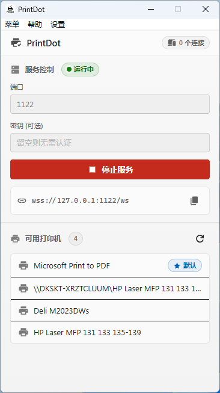</td>
    <td align="center" width="20%">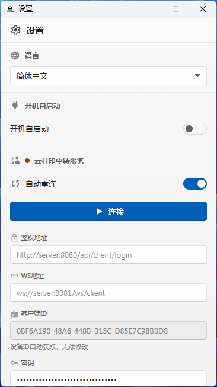</td>
    <td align="center" width="20%">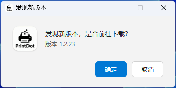</td>
    <td align="center" width="20%">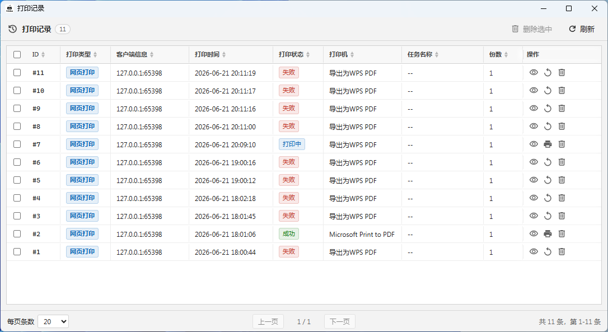</td>
    <td align="center" width="20%"></td>
  </tr>
  <tr>
    <td align="center"><b>Hauptansicht &#183; Dienststeuerung und verfügbare Drucker</b></td>
    <td align="center"><b>Einstellungen &#183; Cloud-Relay und Verbindungskonfiguration</b></td>
    <td align="center"><b>Update-Hinweis &#183; neuesten Client prüfen</b></td>
    <td align="center"><b>Auftragsverlauf &#183; Status und Wiederholung</b></td>
    <td align="center"><b>Druckvorschau &#183; Echtzeitvorschau im lokalen Client</b></td>
  </tr>
</table>

### Etikettendruck (native RAW-Befehle)

Thermo- und Thermotransfer-Etikettendrucker (TSC, Gprinter, Zebra, HPRT, Deli, Xprinter und andere) werden über Befehle gesteuert. Ein PDF lässt sich nur seitenweise rastern, was langsamere Ausgabe, schlechtere Barcode-Lesbarkeit und Versatz auf Sonderpapier bedeutet. Der Client ergänzt einen eigenen Etikettenpfad: Er analysiert das Vorlagen-JSON, erzeugt native Befehle und schreibt sie als RAW in die Systemdruckwarteschlange.

<table width="100%">
  <tr>
    <td align="center" width="20%"><b>Vier Befehlssprachen</b></td>
    <td align="center" width="20%"><b>Originalgetreue Elemente</b></td>
    <td align="center" width="20%"><b>Steuerbare Druckoptionen</b></td>
    <td align="center" width="20%"><b>Stapel und mehrseitig</b></td>
    <td align="center" width="20%"><b>Druckverlauf</b></td>
  </tr>
  <tr>
    <td align="center" valign="top"><sub>TSPL / ZPL / ESC-POS / CPCL, standardmäßig aus Drucker- und Treibernamen abgeleitet, bei Bedarf explizit gesetzt.</sub></td>
    <td align="center" valign="top"><sub>Text, Barcodes, QR-Codes, Tabellen (verbundene Zellen, Kopf- / Fußzeilen), Bilder (gedithert schwarzweiß), Formen und Drehung.</sub></td>
    <td align="center" valign="top"><sub>Etikettenbreite und -höhe (Höhe 0 für Endlospapier), DPI, Geschwindigkeit, Dichte, Lücke / schwarze Marke / Offset, Bitmaps oder interne Schriften.</sub></td>
    <td align="center" valign="top"><sub>Eine Seite pro Etikett; <code>labels[]</code> übermittelt einen ganzen Stapel mit Exemplarzahl pro Datensatz und optionalem Intervall.</sub></td>
    <td align="center" valign="top"><sub>Jeder Etikettendruck wird im Client-Verlauf mit Drucker, Exemplaren, Status und Zeit erfasst; fehlgeschlagene Aufträge lassen sich wiederholen.</sub></td>
  </tr>
</table>

#### Zwei Einstiegspunkte

- Eine `print_label`-Nachricht senden und das vom Designer exportierte Vorlagen-JSON unverändert weiterreichen, ohne zusätzliche Verarbeitung;
- Im Druckvorschaufenster des Clients „Etikettendruck“ aktivieren, um lokal zu drucken (der Vorschaumodus des Designers muss JSON sein). Bei Auswahl eines Etikettendruckers wird die Befehlssprache automatisch erkannt und aktiviert, das Ergebnis lässt sich jederzeit überschreiben.

#### Vergleich der Rendering-Konsistenz

Die folgenden Bilder zeigen dasselbe 60 × 40 mm große Lageretikett in drei Formen: die Originalausgabe aus dem Designer, die Firmware-Simulation des offiziellen Zebra-Dienstes Labelary aus den ZPL-Befehlen und die lokale Neuzeichnung derselben Befehle durch den Client. Das rechte untere Feld überlagert alle drei in Rot, Gelb und Blau, sodass Überlappungen tief purpurgrau erscheinen und Positionen, Schriftgrößen und Barcode-Module auf Ausrichtung geprüft werden können.

<p align="center">
  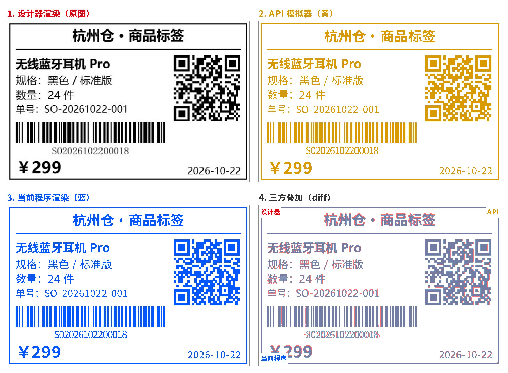
</p>

<p align="center"><b>Vier Felder: Designer-Ausgabe / Hersteller-API-Simulation / Client-Befehlsrendering / Dreifach-Überlagerung</b></p>

<table width="100%">
  <tr>
    <td align="center" width="25%">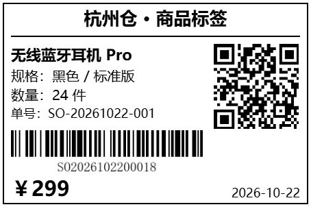</td>
    <td align="center" width="25%">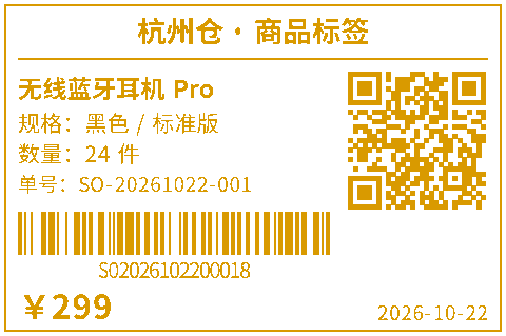</td>
    <td align="center" width="25%">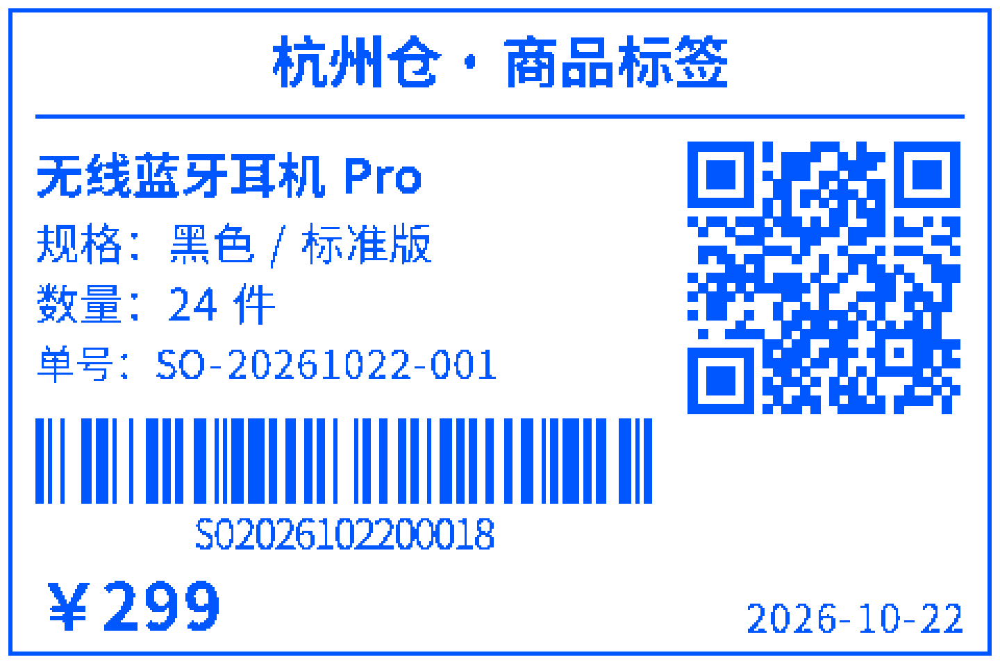</td>
    <td align="center" width="25%">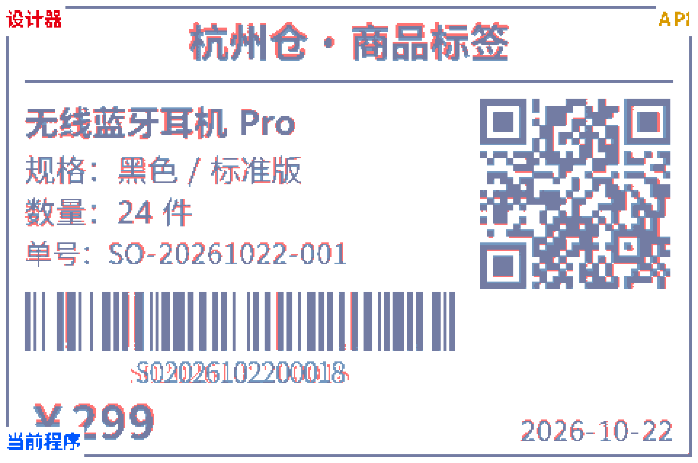</td>
  </tr>
  <tr>
    <td align="center"><b>Designer-Ausgabe</b></td>
    <td align="center"><b>Hersteller-API-Simulation</b></td>
    <td align="center"><b>Client-Befehlsrendering</b></td>
    <td align="center"><b>Dreifach-Überlagerung (Diff)</b></td>
  </tr>
</table>

> Hinweis: Etikettenpapier druckt nur schwarzweiß, farbige Bilder werden automatisch umgewandelt. Seitenzahlen, Wasserzeichen, Verläufe und Schatten werden auf Etiketten nicht gedruckt. ESC/POS-Drucker müssen den Seitenmodus unterstützen. Das Textlayout bleibt zwischen Computern konsistent, die Positionsabweichung beträgt bei 203 dpi höchstens 0,06 mm.

---

## Integrationsbeispiel

Ein vollständiges Integrationsbeispiel auf Basis von **Vue 3 + Element Plus**, das zeigt, wie der Druckdesigner in eine echte Geschäftsanwendung eingebettet wird.

<table width="100%">
  <tr>
    <td align="center" width="33%"></td>
    <td align="center" width="34%"></td>
    <td align="center" width="33%"></td>
  </tr>
  <tr>
    <td align="center"><b>Parameter-Debugging</b></td>
    <td align="center"><b>Designer</b></td>
    <td align="center"><b>Dunkelmodus</b></td>
  </tr>
</table>

- **Repository**: [https://github.com/0ldFive/vue-designer-sample](https://github.com/0ldFive/vue-designer-sample)
- **Live-Demo**: [https://0ldfive.github.io/vue-designer-sample/#/designer](https://0ldfive.github.io/vue-designer-sample/#/designer)
- **Technologie-Stack**: Vue 3, TypeScript, Element Plus, Vite

## Schnellstart

### Option A: npm-Paket (Web Components) [Web Components kennenlernen](https://developer.mozilla.org/de/docs/Web/API/Web_components)

Funktioniert mit jedem Stack (Vue / React / Angular / Vanilla). Web Components **unterstützt Vue 2** als Custom Element — ein Vue-2-Komponentenadapter ist nicht nötig. Parameter, CRUD und JSON-Beispiele: [Web Components API-Leitfaden](https://github.com/0ldFive/Vue-Print-Designer/blob/master/docs/en/guide/web-components-guide.md).

```bash
npm i vue-print-designer
# oder
pnpm add vue-print-designer
# oder
yarn add vue-print-designer
```

<details>
<summary><b>Ausklappen: Integration in Vue 3 / Vite</b> (Import · Initialisierung · Drucken / Exportieren · Events)</summary>

**1) Verwendung in Vue 3 / Vite**

```ts
// main.ts
import "vue-print-designer";
import "vue-print-designer/style.css";
```

```vue
<template>
  <print-designer id="designer"></print-designer>
</template>
```

**2) Initialisierung und Nutzung trennen (Vue 3 Options API)**

Designer-Seite (Initialisierung und Bearbeitung):

```vue
<script lang="ts">
export default {
  mounted() {
    const el = this.$refs.designerRef as any;
    el.setBranding({ title: "Geschäftlicher Druckdesigner", showLogo: true });
    el.setTheme("light");
    el.loadTemplateData(/* Daten aus Ihrer API */);
    el.setVariables({ orderNo: "A001" }, { merge: true });
  },
};
</script>

<template>
  <print-designer ref="designerRef"></print-designer>
</template>
```

Geschäftsseiten (Drucken / Exportieren):

```ts
const el = document.querySelector("print-designer") as any;

// Drucken
await el.print({ mode: "browser" });

// PDF / Bild / HTML / Blob exportieren
await el.export({ type: "pdf", filename: "order-20240223.pdf" });
await el.export({ type: "html", filename: "order-20240223.html" });
const pdfBlob = await el.export({ type: "pdfBlob" });
```

**3) Event-Listener**

```ts
el.addEventListener("ready", () => {});
el.addEventListener("printed", (e) => {});
el.addEventListener("exported", (e) => {
  const blob = e.detail?.blob;
});
el.addEventListener("error", (e) => {
  console.error(e.detail?.scope, e.detail?.error);
});
```

</details>

### Option B: Aus dem Quellcode bauen und eigene API integrieren

Geeignet für Teams mit tiefgehenden Anpassungen. Voraussetzungen:

- Node.js >= 16.0.0
- npm >= 7.0.0 oder yarn / pnpm

Empfohlene Integrationspunkte:

- Vorlagen-CRUD: `useTemplateStore` (durch eigene API ersetzen)
- Custom-Element-CRUD: `customElements` in `useDesignerStore`
- Variablen und Vorlagendaten: Instanzmethoden `setVariables` / `loadTemplateData`

Leitfaden zur Erweiterung eigener Elemente: [custom-element.md](https://github.com/0ldFive/Vue-Print-Designer/blob/master/docs/en/guide/custom-element.md).

## Internationalisierung

6 Sprachen sind integriert, standardmäßig automatisch aus der Browsersprache erkannt und auch per API konfigurierbar:

<p align="center">
  <kbd>Chinesisch vereinfacht zh</kbd> <kbd>Chinesisch traditionell zh-Hant</kbd> <kbd>English en</kbd> <kbd>日本語 ja</kbd> <kbd>한국어 ko</kbd> <kbd>Deutsch de</kbd>
</p>

---

## Lizenz

AGPL-3.0-only

Für die Nutzung von Marke und Logo gilt [TRADEMARKS.md](https://github.com/0ldFive/Vue-Print-Designer/blob/master/TRADEMARKS.md). Zum Entfernen oder Ersetzen der Markenkennzeichnung siehe [COMMERCIAL_LICENSE.md](https://github.com/0ldFive/Vue-Print-Designer/blob/master/COMMERCIAL_LICENSE.md).
