<table align="center" border="0" cellspacing="0" cellpadding="0">
  <tr>
    <td valign="middle"></td>
    <td valign="middle"><h1 style="margin:0;border-bottom:none;padding:0;">&nbsp;Vue Print Designer</h1></td>
  </tr>
</table>

<p align="center">
  
</p>

<p align="center">
  <b>ビジュアル印刷デザイナー &nbsp;&middot;&nbsp; ラベル / レシート / フォームをすべてカバー</b><br/>
  <sub>テンプレートと変数 &nbsp;&middot;&nbsp; サイレント印刷とクラウド印刷を一体化 &nbsp;&middot;&nbsp; あらゆる技術スタックにゼロ依存で組み込み</sub>
</p>

<p align="center">
  <a href="https://gitee.com/theGreatOldFive/vue-print-designer/stargazers"></a>
  <a href="https://gitee.com/theGreatOldFive/vue-print-designer/members"></a>
  <a href="https://github.com/0ldFive/Vue-Print-Designer/stargazers"></a>
  <a href="https://github.com/0ldFive/Vue-Print-Designer/network/members"></a>
  <br/>
  <a href="https://www.npmjs.com/package/vue-print-designer"></a>
  <a href="https://www.npmjs.com/package/vue-print-designer"></a>
  <a href="https://github.com/0ldFive/Vue-Print-Designer/blob/master/LICENSE"></a>
  <a target="_blank" href="https://qm.qq.com/cgi-bin/qm/qr?k=n-5GjVjM51eH2XvL71r-R8-72r1A2z0V&jump_from=webapi&authKey=zB6r+Q2/Q2/Q2/Q2/Q2/Q2/Q2/Q2/Q2/Q2/Q2/Q2/Q2/Q2/Q2/Q2/Q2/Q2"></a>
</p>

<p align="center">
  <a href="https://0ldfive.github.io/Vue-Print-Designer/"><b>ライブデモ</b></a>
  &nbsp;&middot;&nbsp;
  <a href="https://github.com/0ldFive/Vue-Print-Designer/blob/master/docs/en/guide/web-components-guide.md"><b>ドキュメント</b></a>
  &nbsp;&middot;&nbsp;
  <a href="https://printdot.cc/ja/client"><b>クライアントのダウンロード</b></a>
  &nbsp;&middot;&nbsp;
  <a href="https://github.com/0ldFive/vue-designer-sample"><b>連携サンプル</b></a>
</p>

<p align="center">
  <a href="https://github.com/0ldFive/Vue-Print-Designer/blob/master/README.zh-CN.md">简体中文</a>
  &nbsp;&middot;&nbsp;
  <a href="https://github.com/0ldFive/Vue-Print-Designer/blob/master/README.md">English</a>
  &nbsp;&middot;&nbsp;
  <a href="https://github.com/0ldFive/Vue-Print-Designer/blob/master/README.zh-TW.md">繁體中文</a>
  &nbsp;&middot;&nbsp;
  <a href="https://github.com/0ldFive/Vue-Print-Designer/blob/master/README.ja.md">日本語</a>
  &nbsp;&middot;&nbsp;
  <a href="https://github.com/0ldFive/Vue-Print-Designer/blob/master/README.ko.md">한국어</a>
  &nbsp;&middot;&nbsp;
  <a href="https://github.com/0ldFive/Vue-Print-Designer/blob/master/README.de.md">Deutsch</a>
</p>

<p align="center">
  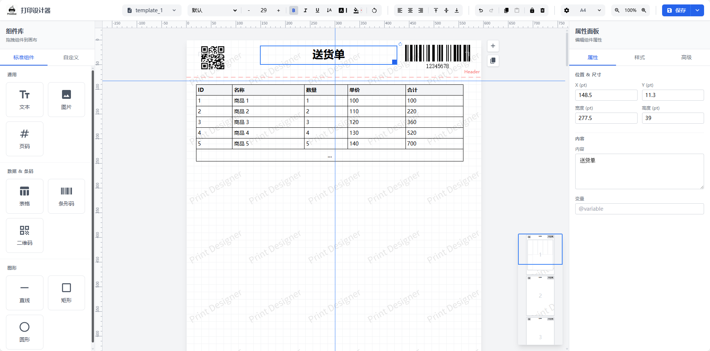
</p>

<p align="center"><sub>デザイナーのメイン画面 &nbsp;&middot;&nbsp; キャンバス / プロパティパネル / レイヤーパネル</sub></p>

<table width="100%">
  <tr>
    <td align="center" width="20%"><b>初回読み込み −65%</b></td>
    <td align="center" width="20%"><b>ES バンドル 300 KB</b></td>
    <td align="center" width="20%"><b>1 ページ描画 80 ms</b></td>
    <td align="center" width="20%"><b>内蔵言語 6 種類</b></td>
    <td align="center" width="20%"><b>コマンドセット 4 種類</b></td>
  </tr>
  <tr>
    <td align="center" valign="top"><sub>重量級の外部パッケージを 6 つ削減し、初回読み込みを軽量化</sub></td>
    <td align="center" valign="top"><sub>Web Components として構築し、組み込みコストを低減</sub></td>
    <td align="center" valign="top"><sub>自社開発の描画エンジンで、ページあたり約 73% 高速化</sub></td>
    <td align="center" valign="top"><sub>ブラウザから自動判定、または API で設定</sub></td>
    <td align="center" valign="top"><sub>TSPL / ZPL / ESC-POS / CPCL に対応</sub></td>
  </tr>
</table>

<p align="center"><sub>ドラッグ＆ドロップで配置 &nbsp;→&nbsp; 変数をバインド &nbsp;→&nbsp; プレビュー &nbsp;→&nbsp; ブラウザ / クライアント / ラベルプリンターへ出力</sub></p>

---

## 主な機能

<p align="center"><b>AI アシスタント · 自然言語でテンプレートを生成・編集</b><br/><sub>自然言語のチャットパネルを内蔵。説明するだけで請求書、納品書、送り状などのテンプレートを生成でき、複数ターンの修正や画像の参照入力にも対応します。生成結果はまず変更プレビューとして表示され、確認後にワンクリックでキャンバスへ適用できます。OpenAI 互換のエンドポイントに対応し、自社運用やサードパーティのモデルサービスも利用可能。複数モデルのプロファイルと高度なサンプリングパラメータをサポートします。</sub></p>

<table width="100%">
  <tr>
    <td align="center" width="33%"><b>ビジュアル設計</b></td>
    <td align="center" width="34%"><b>スマート改ページ</b></td>
    <td align="center" width="33%"><b>フレームワーク非依存</b></td>
  </tr>
  <tr>
    <td align="center" valign="top"><sub>ルーラー、グリッド、整列ツールを使ったドラッグ＆ドロップレイアウト。テキスト、画像、表、バーコード、QR コード、図形に対応し、位置を目分量で合わせる必要はありません。</sub></td>
    <td align="center" valign="top"><sub>長い表の改ページを自動処理し、ヘッダー / フッターを繰り返し表示。複雑なロジックを手書きせず、WYSIWYG で確認できます。</sub></td>
    <td align="center" valign="top"><sub>Web Components ベースで、Vue / React / Angular / ネイティブ HTML にゼロ依存で組み込み可能。Vue 2 にも対応します。</sub></td>
  </tr>
  <tr>
    <td align="center" width="33%"><b>エンタープライズ向け</b></td>
    <td align="center" width="34%"><b>印刷とラベル</b></td>
    <td align="center" width="33%"><b>国際化</b></td>
  </tr>
  <tr>
    <td align="center" valign="top"><sub>用紙サイズのカスタマイズ、API データ連携、テンプレートのインポート / エクスポート、プリンター / 部数 / 両面 / DPI の制御。</sub></td>
    <td align="center" valign="top"><sub>ブラウザ印刷、PDF / 画像への書き出し、サイレント / クラウド印刷に加え、テンプレートをネイティブコマンドに変換してシステムキュー経由で RAW 出力。バーコードと QR コードはベクターのまま鮮明に保たれます。</sub></td>
    <td align="center" valign="top"><sub>簡体字 / 繁体字中国語、英語、日本語、韓国語、ドイツ語の 6 言語。ブラウザから自動判定、または API で設定できます。</sub></td>
  </tr>
</table>

## 画面プレビュー

<table width="100%">
  <tr>
    <td align="center" width="50%">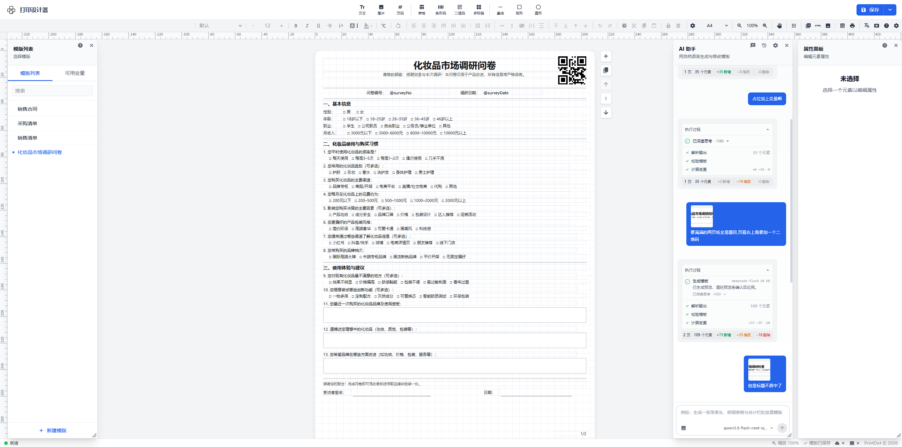</td>
    <td align="center" width="50%">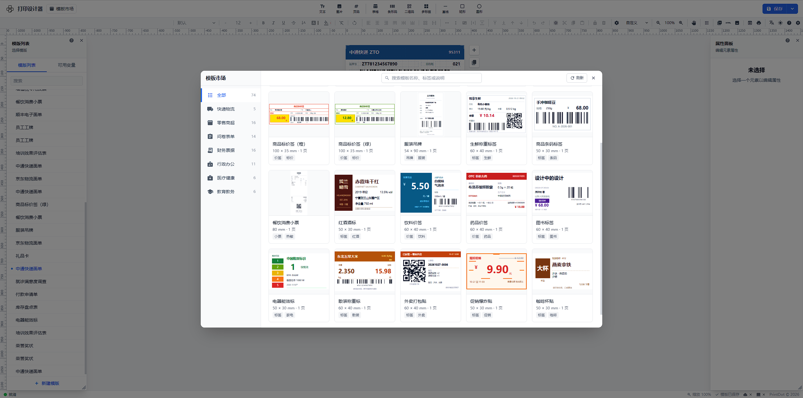</td>
  </tr>
  <tr>
    <td align="center"><b>AI アシスタント &#183; 自然言語によるテンプレート生成</b></td>
    <td align="center"><b>テンプレートマーケット</b></td>
  </tr>
</table>

<table width="100%">
  <tr>
    <td align="center" width="25%">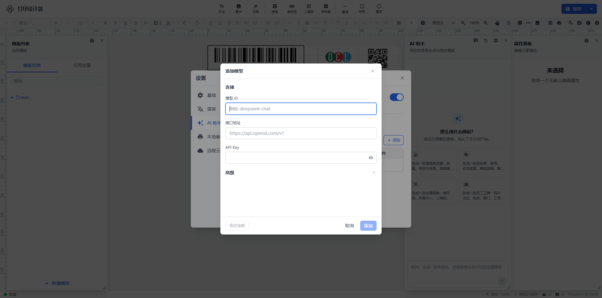</td>
    <td align="center" width="25%">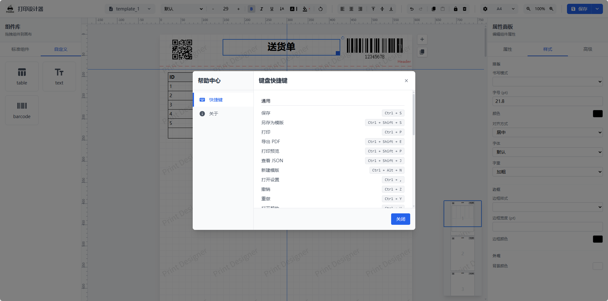</td>
    <td align="center" width="25%">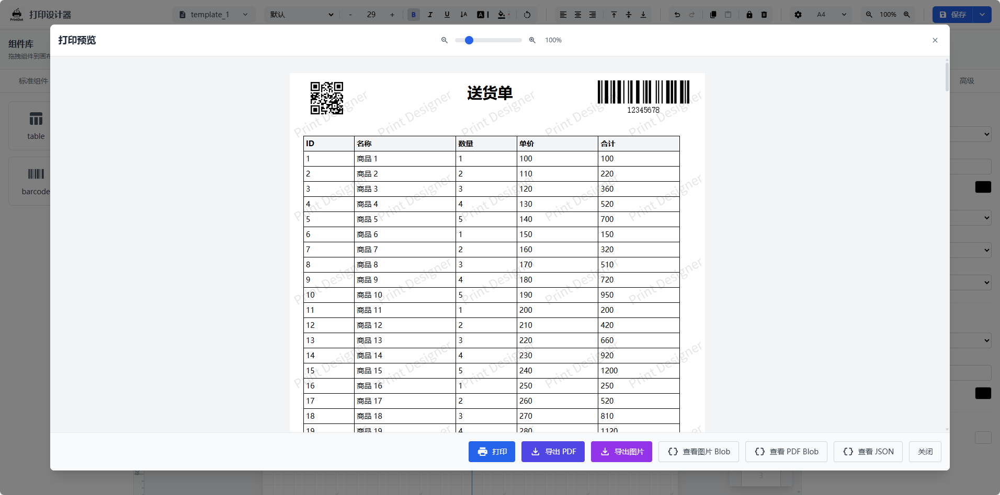</td>
    <td align="center" width="25%"></td>
  </tr>
  <tr>
    <td align="center"><b>AI アシスタント &#183; モデル接続設定</b></td>
    <td align="center"><b>ショートカット一覧</b></td>
    <td align="center"><b>印刷プレビュー</b></td>
    <td align="center"><b>コミュニティ &middot; QQ グループ 1038069636</b></td>
  </tr>
</table>

## 印刷と書き出し

<table width="100%" style="width: 100%;">
  <tr>
    <td align="center" width="25%" style="width: 25%;"><b>ブラウザ印刷</b></td>
    <td align="center" width="25%" style="width: 25%;"><b>書き出し</b></td>
    <td align="center" width="25%" style="width: 25%;"><b>サイレント / クラウド印刷</b></td>
    <td align="center" width="25%" style="width: 25%;"><b>ラベル RAW 出力</b></td>
  </tr>
  <tr>
    <td align="center" valign="top"><sub>ネイティブのプレビューと印刷。プリンター / 部数 / 両面 / DPI を制御可能</sub></td>
    <td align="center" valign="top"><sub>PDF、画像（結合 / 分割）、HTML、Blob を生成。ファイル名も指定可能</sub></td>
    <td align="center" valign="top"><sub>ダイアログなしのサイレント印刷、遠隔ジョブを送るクラウド印刷。いずれもローカルクライアントが実行</sub></td>
    <td align="center" valign="top"><sub>テンプレートをネイティブコマンドに変換し、システムキュー経由で RAW 出力。バッチと連続紙に対応</sub></td>
  </tr>
</table>

## 印刷用クライアント（PrintDot Client）

PrintDot Client は本プロジェクトのデスクトップクライアントです。ローカルのプリンターに接続してサイレント印刷を実行するため、ブラウザからポップアップなしで直接印刷できます。サービス制御、接続設定、印刷履歴、更新通知、印刷プレビューなどの機能を備え、ローカルでの印刷フローを完結させます。

- **対応プラットフォーム**：Windows / macOS / Linux
- **主な機能**：デバイスの自動検出、安定した接続と転送キューの維持、軽量なバックグラウンド動作、印刷ジョブ履歴と更新通知
- **ダウンロード**：[https://printdot.cc/ja/client](https://printdot.cc/ja/client)

<table width="100%">
  <tr>
    <td align="center" width="20%">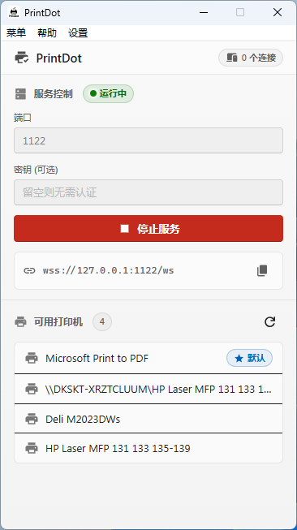</td>
    <td align="center" width="20%">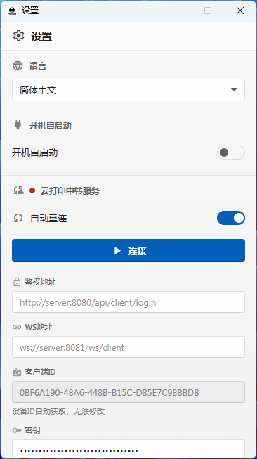</td>
    <td align="center" width="20%">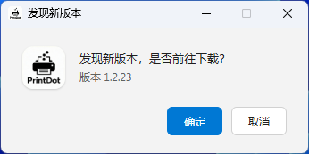</td>
    <td align="center" width="20%">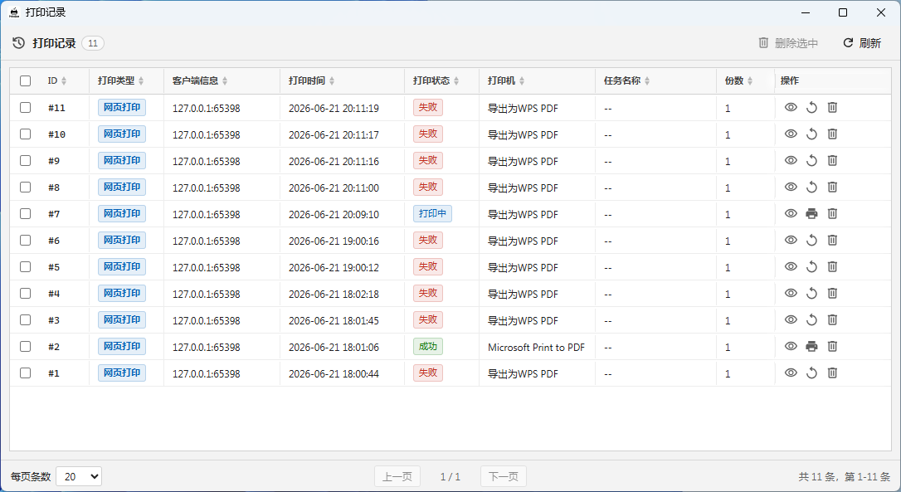</td>
    <td align="center" width="20%"></td>
  </tr>
  <tr>
    <td align="center"><b>メイン画面 &#183; サービス制御と利用可能なプリンター</b></td>
    <td align="center"><b>設定 &#183; クラウド中継と接続設定</b></td>
    <td align="center"><b>更新通知 &#183; 最新クライアントの確認</b></td>
    <td align="center"><b>ジョブ履歴 &#183; タスクの状態と再試行</b></td>
    <td align="center"><b>印刷プレビュー &#183; ローカルクライアントでのリアルタイム表示</b></td>
  </tr>
</table>

### ラベル印刷（ネイティブ RAW コマンド）

サーマル / サーマル転写ラベルプリンター（TSC、Gprinter、Zebra、HPRT、Deli、Xprinter など）はコマンド駆動型です。PDF ではページ単位でラスター化するしかなく、出力が遅く、バーコードの読み取り率が下がり、カスタム用紙では位置ずれが起こります。クライアントは専用のラベル経路を追加し、テンプレート JSON を解析してネイティブコマンドを生成し、RAW としてシステムの印刷キューに書き込みます。

<table width="100%">
  <tr>
    <td align="center" width="20%"><b>4 種類のコマンド言語</b></td>
    <td align="center" width="20%"><b>要素を忠実に再現</b></td>
    <td align="center" width="20%"><b>印刷オプションを制御</b></td>
    <td align="center" width="20%"><b>バッチと複数ページ</b></td>
    <td align="center" width="20%"><b>印刷履歴</b></td>
  </tr>
  <tr>
    <td align="center" valign="top"><sub>TSPL / ZPL / ESC-POS / CPCL。既定ではプリンター名とドライバー名から推定し、判定できない場合は明示的に指定できます。</sub></td>
    <td align="center" valign="top"><sub>テキスト、バーコード、QR コード、表（セル結合、ヘッダー / フッター）、画像（ディザリングによる白黒）、図形、回転。</sub></td>
    <td align="center" valign="top"><sub>ラベルの幅と高さ（高さ 0 で連続紙）、DPI、速度、濃度、ギャップ / 黒マーク / オフセット、ビットマップまたは内蔵フォント。</sub></td>
    <td align="center" valign="top"><sub>1 ページが 1 枚のラベル。<code>labels[]</code> で一括送信でき、レコードごとに部数を指定し、間隔も設定できます。</sub></td>
    <td align="center" valign="top"><sub>ラベル印刷はすべてクライアントの履歴に記録され、プリンター、部数、状態、時刻を確認できます。失敗したジョブは再試行可能です。</sub></td>
  </tr>
</table>

#### 2 つの利用方法

- `print_label` メッセージを送信し、デザイナーが出力したテンプレート JSON をそのまま転送するだけ。追加の加工は不要です。
- クライアントの印刷プレビュー画面で「ラベル印刷」にチェックを入れてローカル印刷します（デザイナーのプレビューモードが JSON である必要があります）。ラベルプリンターを選択するとコマンド言語が自動判定されて有効になり、結果はいつでも手動で上書きできます。

#### 描画一致性の比較

以下の画像は、同じ 60 × 40 mm の倉庫ラベルを 3 通りで示したものです。デザイナーから書き出した元の出力、Zebra 公式の Labelary サービスが ZPL コマンドから生成したファームウェアシミュレーション、そしてクライアントが同じコマンドをローカルで再描画した結果です。右下のペインでは 3 つを赤・黄・青で重ねて表示するため、重なり合う部分は濃い紫灰色になり、位置、フォントサイズ、バーコードモジュールの整合性を確認できます。

<p align="center">
  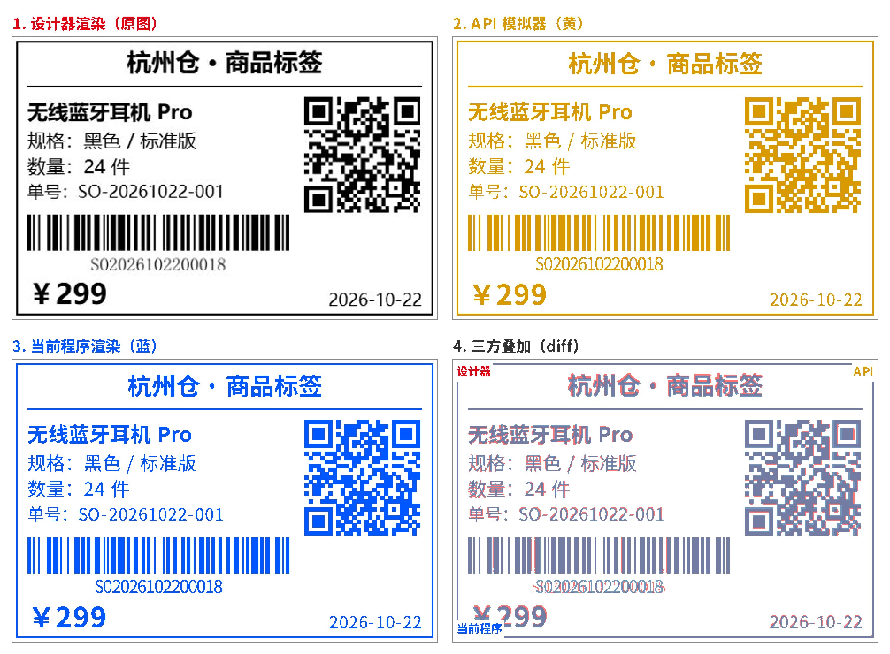
</p>

<p align="center"><b>4 つのペイン：デザイナー出力 / ベンダー API シミュレーション / クライアントのコマンド描画 / 三者重ね合わせ</b></p>

<table width="100%">
  <tr>
    <td align="center" width="25%">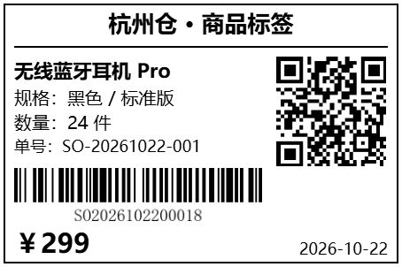</td>
    <td align="center" width="25%">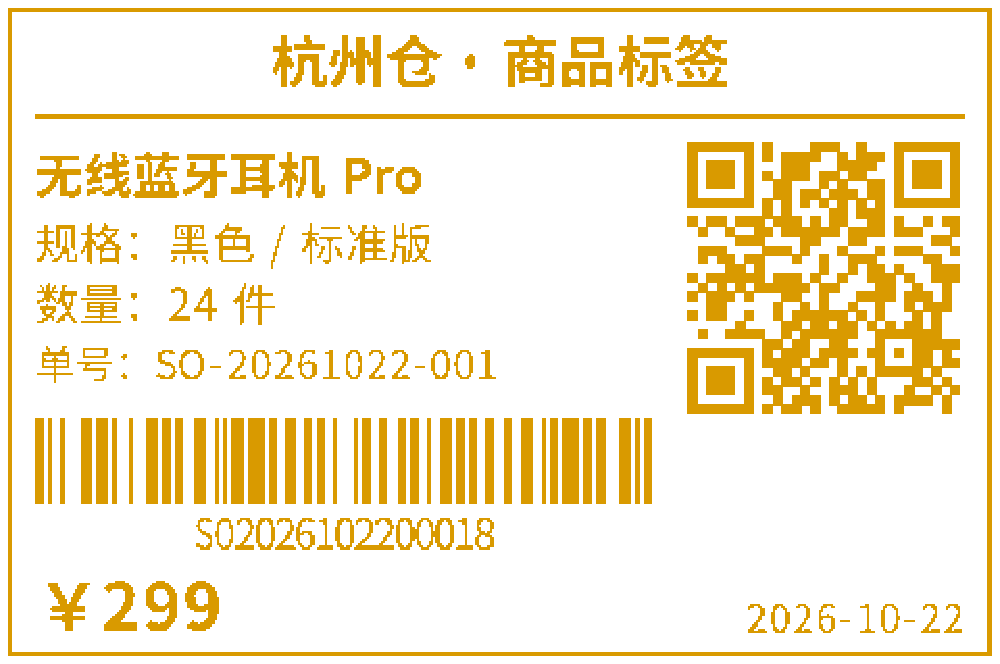</td>
    <td align="center" width="25%">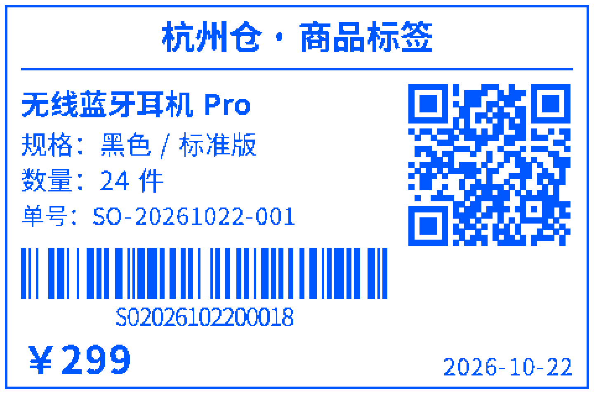</td>
    <td align="center" width="25%">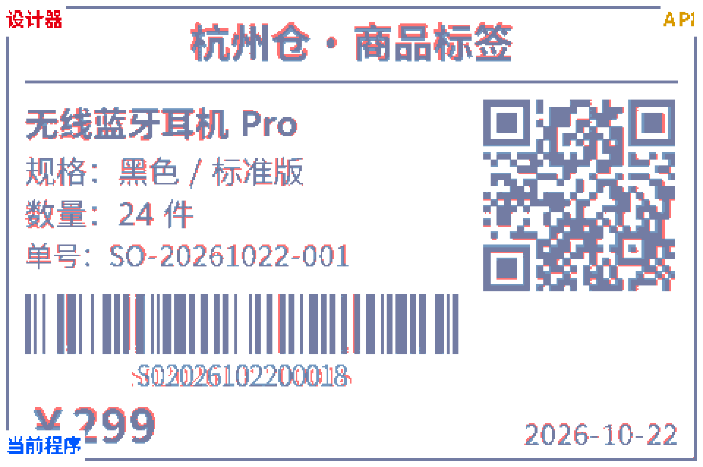</td>
  </tr>
  <tr>
    <td align="center"><b>デザイナー出力</b></td>
    <td align="center"><b>ベンダー API シミュレーション</b></td>
    <td align="center"><b>クライアントのコマンド描画</b></td>
    <td align="center"><b>三者重ね合わせ（差分）</b></td>
  </tr>
</table>

> 注記：ラベル用紙は白黒印刷のみのため、カラー画像は自動的に変換されます。ページ番号、透かし、グラデーション、影はラベルに印刷されません。ESC/POS プリンターはページモードに対応している必要があります。テキストレイアウトはコンピューター間で一貫し、203 dpi での位置誤差は 0.06 mm 以内です。

---

## 連携サンプル

**Vue 3 + Element Plus** による完全な連携サンプルで、実際の業務アプリケーションに印刷デザイナーを組み込む方法を示します。

<table width="100%">
  <tr>
    <td align="center" width="33%"></td>
    <td align="center" width="34%"></td>
    <td align="center" width="33%"></td>
  </tr>
  <tr>
    <td align="center"><b>パラメータのデバッグ</b></td>
    <td align="center"><b>デザイナー</b></td>
    <td align="center"><b>ダークモード</b></td>
  </tr>
</table>

- **リポジトリ**：[https://github.com/0ldFive/vue-designer-sample](https://github.com/0ldFive/vue-designer-sample)
- **ライブデモ**：[https://0ldfive.github.io/vue-designer-sample/#/designer](https://0ldfive.github.io/vue-designer-sample/#/designer)
- **技術スタック**：Vue 3、TypeScript、Element Plus、Vite

## クイックスタート

### 方法 A：npm パッケージ（Web Components）[Web Components を学ぶ](https://developer.mozilla.org/ja/docs/Web/API/Web_components)

あらゆる技術スタック（Vue / React / Angular / ネイティブ）で利用できます。Web Components はカスタム要素として **Vue 2 にも対応**し、Vue 2 用のコンポーネントアダプターは不要です。パラメータ、CRUD、JSON の例は [Web Components API ガイド](https://github.com/0ldFive/Vue-Print-Designer/blob/master/docs/en/guide/web-components-guide.md) を参照してください。

```bash
npm i vue-print-designer
# または
pnpm add vue-print-designer
# または
yarn add vue-print-designer
```

<details>
<summary><b>展開：Vue 3 / Vite への組み込み例</b>（インポート · 初期化 · 印刷 / 書き出し · イベント）</summary>

**1) Vue 3 / Vite で使う**

```ts
// main.ts
import "vue-print-designer";
import "vue-print-designer/style.css";
```

```vue
<template>
  <print-designer id="designer"></print-designer>
</template>
```

**2) 初期化と利用を分ける（Vue 3 オプション API）**

デザイナーページ（初期化と編集）：

```vue
<script lang="ts">
export default {
  mounted() {
    const el = this.$refs.designerRef as any;
    el.setBranding({ title: "業務用印刷デザイナー", showLogo: true });
    el.setTheme("light");
    el.loadTemplateData(/* API から取得したデータ */);
    el.setVariables({ orderNo: "A001" }, { merge: true });
  },
};
</script>

<template>
  <print-designer ref="designerRef"></print-designer>
</template>
```

業務ページ（印刷 / 書き出し）：

```ts
const el = document.querySelector("print-designer") as any;

// 印刷
await el.print({ mode: "browser" });

// PDF / 画像 / HTML / Blob へ書き出し
await el.export({ type: "pdf", filename: "order-20240223.pdf" });
await el.export({ type: "html", filename: "order-20240223.html" });
const pdfBlob = await el.export({ type: "pdfBlob" });
```

**3) イベントリスナー**

```ts
el.addEventListener("ready", () => {});
el.addEventListener("printed", (e) => {});
el.addEventListener("exported", (e) => {
  const blob = e.detail?.blob;
});
el.addEventListener("error", (e) => {
  console.error(e.detail?.scope, e.detail?.error);
});
```

</details>

### 方法 B：ソースからビルドして自社 API と連携

深いカスタマイズが必要なチームに適しています。要件：

- Node.js >= 16.0.0
- npm >= 7.0.0 または yarn / pnpm

推奨する組み込みポイント：

- テンプレート CRUD：`useTemplateStore`（自社 API に置き換え可能）
- カスタム要素 CRUD：`useDesignerStore` の `customElements`
- 変数とテンプレートデータ：インスタンスメソッド `setVariables` / `loadTemplateData`

カスタム要素の拡張ガイド：[custom-element.md](https://github.com/0ldFive/Vue-Print-Designer/blob/master/docs/en/guide/custom-element.md)。

## 国際化

6 言語を内蔵しており、既定ではブラウザの言語から自動判定し、API でも設定できます。

<p align="center">
  <kbd>簡体字中国語 zh</kbd> <kbd>繁体字中国語 zh-Hant</kbd> <kbd>English en</kbd> <kbd>日本語 ja</kbd> <kbd>한국어 ko</kbd> <kbd>Deutsch de</kbd>
</p>

---

## ライセンス

AGPL-3.0-only

ブランドとロゴの使用については [TRADEMARKS.md](https://github.com/0ldFive/Vue-Print-Designer/blob/master/TRADEMARKS.md) に従ってください。ブランド表示の削除や置き換えについては [COMMERCIAL_LICENSE.md](https://github.com/0ldFive/Vue-Print-Designer/blob/master/COMMERCIAL_LICENSE.md) を参照してください。
