<h1 align="center">
  
  Vue Print Designer
</h1>

<p align="center">
  
</p>

<p align="center">
  <b>비주얼 인쇄 디자이너 &nbsp;&middot;&nbsp; 라벨 / 영수증 / 양식 전부 지원</b><br/>
  <sub>템플릿과 변수 &nbsp;&middot;&nbsp; 무음 인쇄와 클라우드 인쇄 일체화 &nbsp;&middot;&nbsp; 모든 기술 스택에 제로 의존성 연동</sub>
</p>

<p align="center">
  <a href="https://gitee.com/theGreatOldFive/vue-print-designer/stargazers"></a>
  <a href="https://gitee.com/theGreatOldFive/vue-print-designer/members"></a>
  <a href="https://github.com/0ldFive/Vue-Print-Designer/stargazers"></a>
  <a href="https://github.com/0ldFive/Vue-Print-Designer/network/members"></a>
  <br/>
  <a href="https://www.npmjs.com/package/vue-print-designer"></a>
  <a href="https://www.npmjs.com/package/vue-print-designer"></a>
  <a href="https://github.com/0ldFive/Vue-Print-Designer/blob/master/LICENSE"></a>
  <a target="_blank" href="https://qm.qq.com/cgi-bin/qm/qr?k=n-5GjVjM51eH2XvL71r-R8-72r1A2z0V&jump_from=webapi&authKey=zB6r+Q2/Q2/Q2/Q2/Q2/Q2/Q2/Q2/Q2/Q2/Q2/Q2/Q2/Q2/Q2/Q2/Q2/Q2"></a>
</p>

<p align="center">
  <a href="https://0ldfive.github.io/Vue-Print-Designer/"><b>라이브 데모</b></a>
  &nbsp;&middot;&nbsp;
  <a href="https://github.com/0ldFive/Vue-Print-Designer/blob/master/docs/en/guide/web-components-guide.md"><b>문서</b></a>
  &nbsp;&middot;&nbsp;
  <a href="https://printdot.cc/ko/client"><b>클라이언트 다운로드</b></a>
  &nbsp;&middot;&nbsp;
  <a href="https://github.com/0ldFive/vue-designer-sample"><b>연동 예시</b></a>
</p>

<p align="center">
  <a href="https://github.com/0ldFive/Vue-Print-Designer/blob/master/README.zh-CN.md">简体中文</a>
  &nbsp;&middot;&nbsp;
  <a href="https://github.com/0ldFive/Vue-Print-Designer/blob/master/README.md">English</a>
  &nbsp;&middot;&nbsp;
  <a href="https://github.com/0ldFive/Vue-Print-Designer/blob/master/README.zh-TW.md">繁體中文</a>
  &nbsp;&middot;&nbsp;
  <a href="https://github.com/0ldFive/Vue-Print-Designer/blob/master/README.ja.md">日本語</a>
  &nbsp;&middot;&nbsp;
  <a href="https://github.com/0ldFive/Vue-Print-Designer/blob/master/README.ko.md">한국어</a>
  &nbsp;&middot;&nbsp;
  <a href="https://github.com/0ldFive/Vue-Print-Designer/blob/master/README.de.md">Deutsch</a>
</p>

<p align="center">
  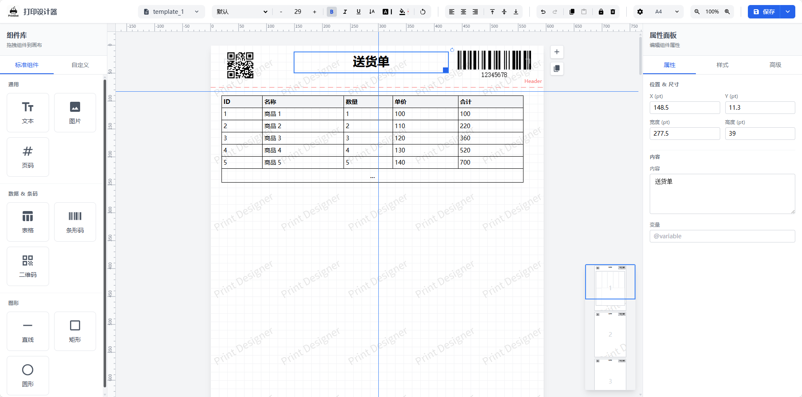
</p>

<p align="center"><sub>디자이너 메인 화면 &nbsp;&middot;&nbsp; 캔버스 / 속성 패널 / 레이어 패널</sub></p>

<table width="100%">
  <tr>
    <td align="center" width="20%"><b>첫 로딩 −65%</b></td>
    <td align="center" width="20%"><b>ES 번들 300 KB</b></td>
    <td align="center" width="20%"><b>페이지 렌더 80 ms</b></td>
    <td align="center" width="20%"><b>내장 언어 6 종</b></td>
    <td align="center" width="20%"><b>명령 집합 4 종</b></td>
  </tr>
  <tr>
    <td align="center" valign="top"><sub>무거운 서드파티 패키지 6 개를 제거해 첫 로딩을 가볍게</sub></td>
    <td align="center" valign="top"><sub>Web Components 로 빌드해 연동 비용 절감</sub></td>
    <td align="center" valign="top"><sub>자체 개발 렌더링 엔진으로 페이지당 약 73% 단축</sub></td>
    <td align="center" valign="top"><sub>브라우저에서 자동 감지하거나 API 로 설정</sub></td>
    <td align="center" valign="top"><sub>TSPL / ZPL / ESC-POS / CPCL 지원</sub></td>
  </tr>
</table>

<p align="center"><sub>드래그 앤 드롭 배치 &nbsp;→&nbsp; 변수 바인딩 &nbsp;→&nbsp; 미리보기 &nbsp;→&nbsp; 브라우저 / 클라이언트 / 라벨 프린터 출력</sub></p>

---

## 주요 기능

<p align="center"><b>AI 어시스턴트 · 자연어로 템플릿 생성 및 편집</b><br/><sub>자연어 채팅 패널이 내장되어 있어 설명만으로 견적서, 거래명세서, 운송장 등의 템플릿을 생성할 수 있고, 여러 차례 수정과 이미지 참조 입력도 지원합니다. 생성 결과는 먼저 변경 미리보기로 표시되며, 확인 후 한 번의 클릭으로 캔버스에 적용됩니다. OpenAI 호환 엔드포인트를 지원해 자체 구축 또는 서드파티 모델 서비스와 연동할 수 있고, 다중 모델 프로필과 고급 샘플링 파라미터도 지원합니다.</sub></p>

<table width="100%">
  <tr>
    <td align="center" width="33%"><b>비주얼 디자인</b></td>
    <td align="center" width="34%"><b>스마트 페이지 나눔</b></td>
    <td align="center" width="33%"><b>프레임워크 호환</b></td>
  </tr>
  <tr>
    <td align="center" valign="top"><sub>눈금자, 그리드, 정렬 도구를 활용한 드래그 앤 드롭 레이아웃. 텍스트, 이미지, 표, 바코드, QR 코드, 도형을 지원하며 요소 위치를 눈대중으로 맞출 필요가 없습니다.</sub></td>
    <td align="center" valign="top"><sub>긴 표의 페이지 나눔을 자동 처리하고 머리글 / 바닥글을 반복 표시합니다. 복잡한 로직을 직접 작성하지 않아도 되고 결과를 그대로 확인할 수 있습니다.</sub></td>
    <td align="center" valign="top"><sub>Web Components 기반으로 Vue / React / Angular / 순수 HTML 에 제로 의존성으로 연동하며 Vue 2 도 지원합니다.</sub></td>
  </tr>
  <tr>
    <td align="center" width="33%"><b>엔터프라이즈 기능</b></td>
    <td align="center" width="34%"><b>인쇄와 라벨</b></td>
    <td align="center" width="33%"><b>국제화</b></td>
  </tr>
  <tr>
    <td align="center" valign="top"><sub>사용자 정의 용지 크기, API 데이터 연동, 템플릿 가져오기 / 내보내기, 프린터 / 매수 / 양면 / DPI 제어.</sub></td>
    <td align="center" valign="top"><sub>브라우저 인쇄, PDF / 이미지 내보내기, 무음 / 클라우드 인쇄에 더해 템플릿을 네이티브 명령으로 변환해 시스템 큐로 RAW 출력합니다. 바코드와 QR 코드는 벡터 상태로 선명하게 유지됩니다.</sub></td>
    <td align="center" valign="top"><sub>중국어 간체 / 번체, 영어, 일본어, 한국어, 독일어 6 개 언어. 브라우저에서 자동 감지하거나 API 로 설정할 수 있습니다.</sub></td>
  </tr>
</table>

## 화면 미리보기

<table width="100%">
  <tr>
    <td align="center" width="50%">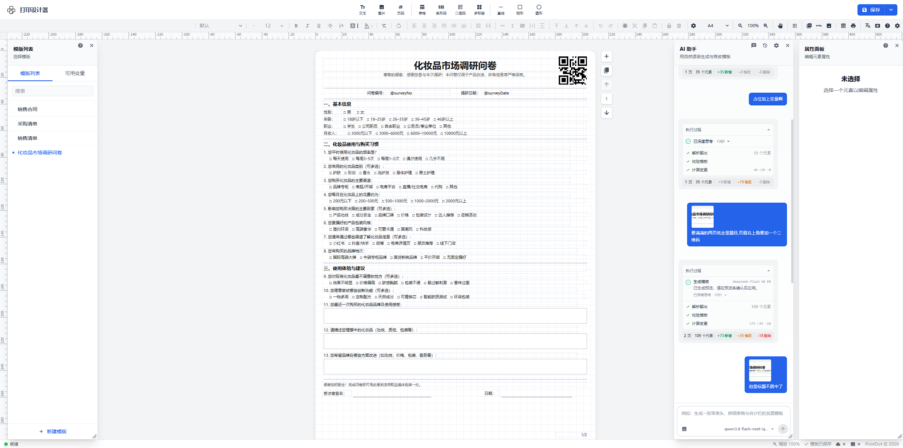</td>
    <td align="center" width="50%">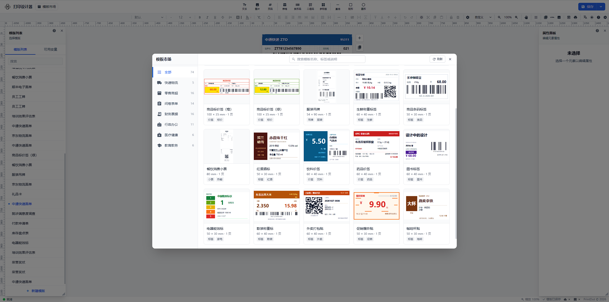</td>
  </tr>
  <tr>
    <td align="center"><b>AI 어시스턴트 &#183; 자연어로 템플릿 생성</b></td>
    <td align="center"><b>템플릿 마켓</b></td>
  </tr>
</table>

<table width="100%">
  <tr>
    <td align="center" width="25%">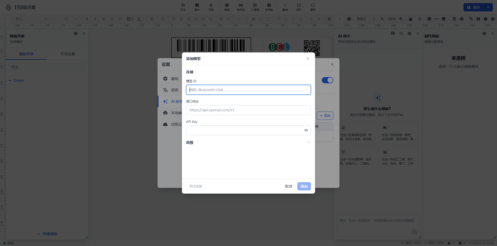</td>
    <td align="center" width="25%">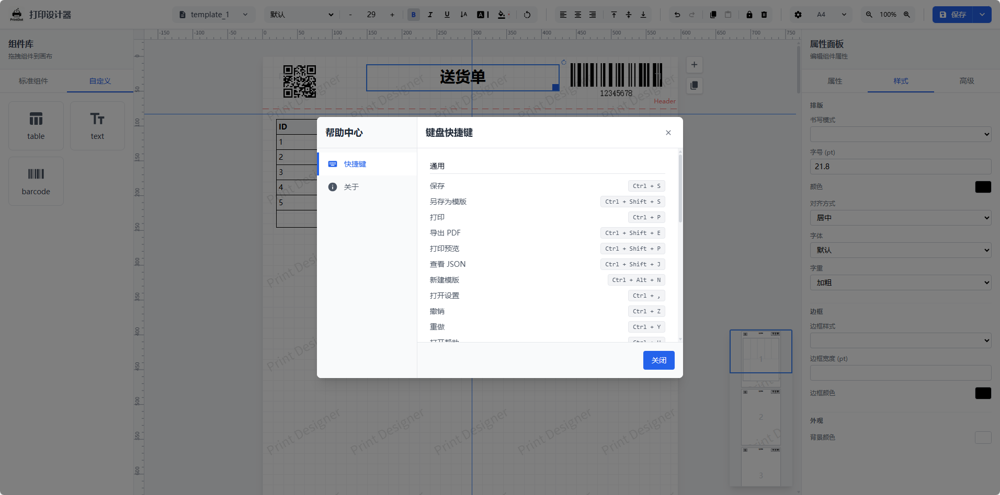</td>
    <td align="center" width="25%">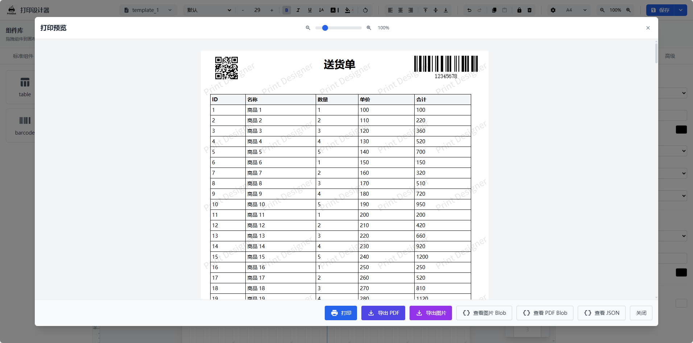</td>
    <td align="center" width="25%"></td>
  </tr>
  <tr>
    <td align="center"><b>AI 어시스턴트 &#183; 모델 연결 설정</b></td>
    <td align="center"><b>단축키 안내</b></td>
    <td align="center"><b>인쇄 미리보기</b></td>
    <td align="center"><b>커뮤니티 &middot; QQ 그룹 1038069636</b></td>
  </tr>
</table>

## 인쇄 및 내보내기

<table width="100%" style="width: 100%;">
  <tr>
    <td align="center" width="25%" style="width: 25%;"><b>브라우저 인쇄</b></td>
    <td align="center" width="25%" style="width: 25%;"><b>내보내기</b></td>
    <td align="center" width="25%" style="width: 25%;"><b>무음 / 클라우드 인쇄</b></td>
    <td align="center" width="25%" style="width: 25%;"><b>라벨 RAW 출력</b></td>
  </tr>
  <tr>
    <td align="center" valign="top"><sub>네이티브 미리보기와 인쇄. 프린터 / 매수 / 양면 / DPI 제어 가능</sub></td>
    <td align="center" valign="top"><sub>PDF, 이미지(병합 / 분할), HTML, Blob 생성. 파일명 지정 가능</sub></td>
    <td align="center" valign="top"><sub>대화상자 없는 무음 인쇄, 원격 작업을 보내는 클라우드 인쇄. 모두 로컬 클라이언트가 실행</sub></td>
    <td align="center" valign="top"><sub>템플릿을 네이티브 명령으로 변환해 시스템 큐로 RAW 출력. 배치와 연속 용지 지원</sub></td>
  </tr>
</table>

## 인쇄용 클라이언트(PrintDot Client)

PrintDot Client 는 이 프로젝트의 데스크톱 클라이언트입니다. 로컬 프린터에 연결해 무음 인쇄 작업을 처리하므로, 브라우저에서 팝업 없이 바로 인쇄할 수 있습니다. 서비스 제어, 연결 설정, 인쇄 기록, 업데이트 알림, 인쇄 미리보기 등의 기능을 제공해 로컬 인쇄 흐름을 완성합니다.

- **지원 플랫폼**: Windows / macOS / Linux
- **주요 기능**: 장치 자동 검색, 안정적인 연결 유지와 전달 큐, 가벼운 백그라운드 동작, 인쇄 작업 기록과 업데이트 알림
- **다운로드**: [https://printdot.cc/ko/client](https://printdot.cc/ko/client)

<table width="100%">
  <tr>
    <td align="center" width="20%">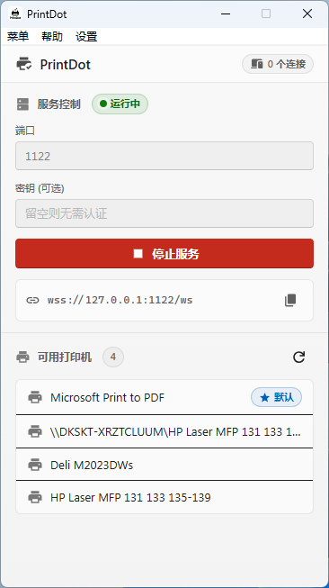</td>
    <td align="center" width="20%">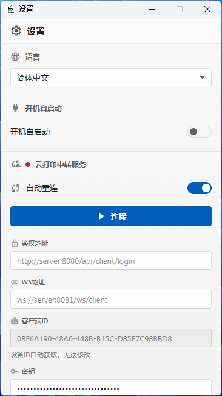</td>
    <td align="center" width="20%">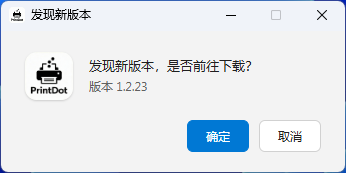</td>
    <td align="center" width="20%">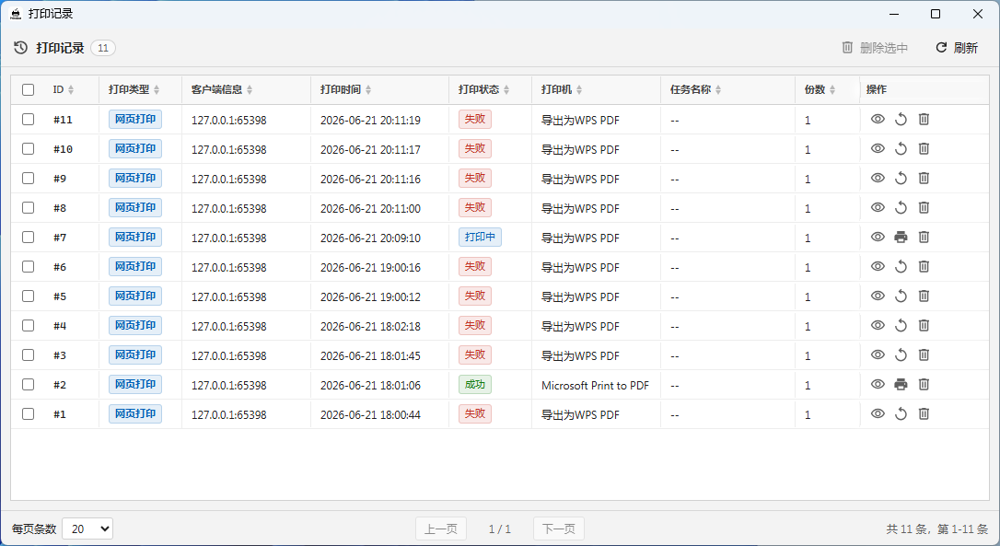</td>
    <td align="center" width="20%"></td>
  </tr>
  <tr>
    <td align="center"><b>메인 화면 &#183; 서비스 제어와 사용 가능한 프린터</b></td>
    <td align="center"><b>설정 &#183; 클라우드 중계와 연결 구성</b></td>
    <td align="center"><b>업데이트 알림 &#183; 최신 클라이언트 확인</b></td>
    <td align="center"><b>작업 기록 &#183; 작업 상태와 재시도</b></td>
    <td align="center"><b>인쇄 미리보기 &#183; 로컬 클라이언트 실시간 미리보기</b></td>
  </tr>
</table>

### 라벨 인쇄(네이티브 RAW 명령)

열전사 / 열전사 전사 라벨 프린터(TSC, Gprinter, Zebra, HPRT, Deli, Xprinter 등)는 명령 구동 방식입니다. PDF 는 페이지 단위로 래스터화할 수밖에 없어 출력이 느리고 바코드 인식률이 떨어지며 사용자 정의 용지에서 위치가 어긋납니다. 클라이언트는 전용 라벨 경로를 추가해 템플릿 JSON 을 분석하고 네이티브 명령을 생성한 뒤 RAW 로 시스템 인쇄 큐에 기록합니다.

<table width="100%">
  <tr>
    <td align="center" width="20%"><b>4 가지 명령 언어</b></td>
    <td align="center" width="20%"><b>요소 충실 재현</b></td>
    <td align="center" width="20%"><b>인쇄 옵션 제어</b></td>
    <td align="center" width="20%"><b>배치와 다중 페이지</b></td>
    <td align="center" width="20%"><b>인쇄 기록</b></td>
  </tr>
  <tr>
    <td align="center" valign="top"><sub>TSPL / ZPL / ESC-POS / CPCL. 기본적으로 프린터 이름과 드라이버 이름으로 추론하며, 판별이 안 되면 직접 지정할 수 있습니다.</sub></td>
    <td align="center" valign="top"><sub>텍스트, 바코드, QR 코드, 표(셀 병합, 머리글 / 바닥글), 이미지(디더링 흑백), 도형, 회전.</sub></td>
    <td align="center" valign="top"><sub>라벨 너비와 높이(높이 0 은 연속 용지), DPI, 속도, 농도, 간격 / 검은색 표시 / 오프셋, 비트맵 또는 내장 글꼴.</sub></td>
    <td align="center" valign="top"><sub>한 페이지가 라벨 한 장입니다. <code>labels[]</code> 로 일괄 전송할 수 있고 레코드별 매수와 간격을 지정할 수 있습니다.</sub></td>
    <td align="center" valign="top"><sub>모든 라벨 인쇄는 클라이언트 기록에 남아 프린터, 매수, 상태, 시간을 확인할 수 있으며 실패한 작업은 재시도할 수 있습니다.</sub></td>
  </tr>
</table>

#### 두 가지 사용 방법

- `print_label` 메시지를 보내고 디자이너가 내보낸 템플릿 JSON 을 그대로 전달하면 됩니다. 추가 가공이 필요 없습니다.
- 클라이언트 인쇄 미리보기 창에서 "라벨 인쇄"를 선택하면 로컬에서 출력됩니다(디자이너 미리보기 모드가 JSON 이어야 함). 라벨 프린터를 선택하면 명령 언어가 자동으로 감지되어 활성화되며, 결과는 언제든 수동으로 변경할 수 있습니다.

#### 렌더링 일치성 비교

아래 이미지는 동일한 60 × 40 mm 창고 라벨을 세 가지 형태로 보여 줍니다. 디자이너에서 내보낸 원본 출력, Zebra 공식 Labelary 서비스가 ZPL 명령으로 생성한 펌웨어 시뮬레이션, 클라이언트가 같은 명령을 로컬에서 다시 그린 결과입니다. 오른쪽 아래 패널은 세 가지를 빨강, 노랑, 파랑으로 겹쳐 표시하므로 겹치는 영역은 짙은 자회색이 되고 위치, 글꼴 크기, 바코드 모듈의 정렬을 확인할 수 있습니다.

<p align="center">
  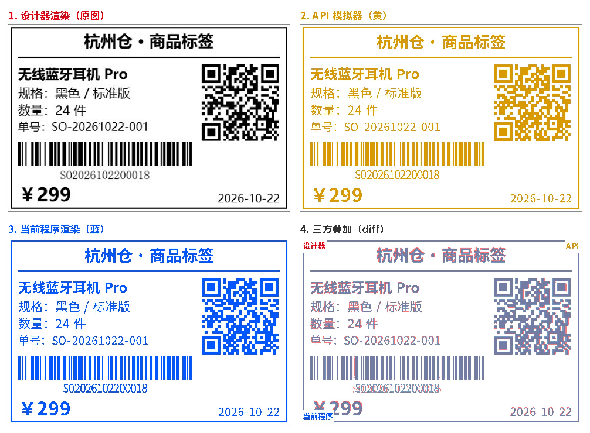
</p>

<p align="center"><b>4개 패널: 디자이너 출력 / 벤더 API 시뮬레이션 / 클라이언트 명령 렌더링 / 3자 겹침</b></p>

<table width="100%">
  <tr>
    <td align="center" width="25%">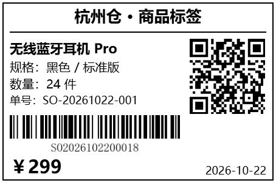</td>
    <td align="center" width="25%">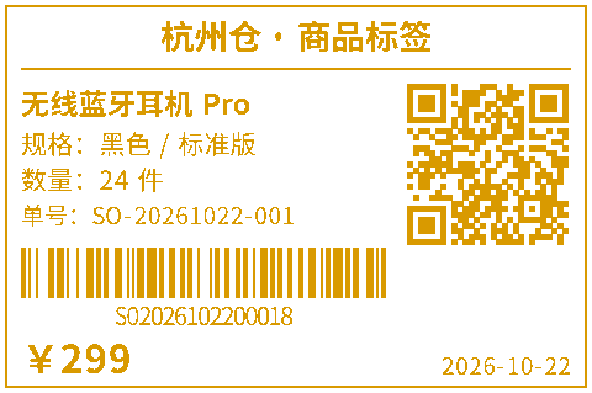</td>
    <td align="center" width="25%">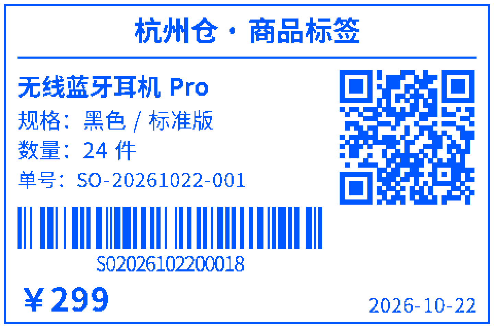</td>
    <td align="center" width="25%">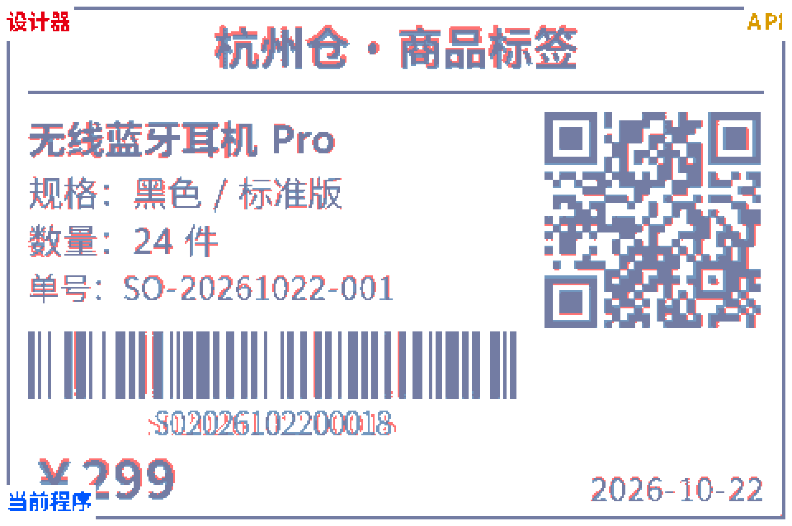</td>
  </tr>
  <tr>
    <td align="center"><b>디자이너 출력</b></td>
    <td align="center"><b>벤더 API 시뮬레이션</b></td>
    <td align="center"><b>클라이언트 명령 렌더링</b></td>
    <td align="center"><b>3자 겹침(차이)</b></td>
  </tr>
</table>

> 참고: 라벨 용지는 흑백으로만 인쇄되므로 컬러 이미지는 자동으로 변환됩니다. 페이지 번호, 워터마크, 그라데이션, 그림자는 라벨에 인쇄되지 않습니다. ESC/POS 프린터는 페이지 모드를 지원해야 합니다. 텍스트 레이아웃은 컴퓨터 간에 일관되며 203 dpi 에서 위치 오차는 0.06 mm 이내입니다.

---

## 연동 예시

**Vue 3 + Element Plus** 기반의 완전한 연동 예시로, 실제 업무 애플리케이션에 인쇄 디자이너를 넣는 방법을 보여 줍니다.

<table width="100%">
  <tr>
    <td align="center" width="33%"></td>
    <td align="center" width="34%"></td>
    <td align="center" width="33%"></td>
  </tr>
  <tr>
    <td align="center"><b>파라미터 디버깅</b></td>
    <td align="center"><b>디자이너</b></td>
    <td align="center"><b>다크 모드</b></td>
  </tr>
</table>

- **저장소**: [https://github.com/0ldFive/vue-designer-sample](https://github.com/0ldFive/vue-designer-sample)
- **라이브 데모**: [https://0ldfive.github.io/vue-designer-sample/#/designer](https://0ldfive.github.io/vue-designer-sample/#/designer)
- **기술 스택**: Vue 3, TypeScript, Element Plus, Vite

## 빠른 시작

### 방법 A: npm 패키지(Web Components) [Web Components 알아보기](https://developer.mozilla.org/ko/docs/Web/API/Web_components)

모든 기술 스택(Vue / React / Angular / 순수)에서 사용할 수 있습니다. Web Components 는 사용자 정의 요소로 **Vue 2 도 지원**하므로 Vue 2 컴포넌트 어댑터가 필요 없습니다. 파라미터, CRUD, JSON 예시는 [Web Components API 가이드](https://github.com/0ldFive/Vue-Print-Designer/blob/master/docs/en/guide/web-components-guide.md)를 참고하세요.

```bash
npm i vue-print-designer
# 또는
pnpm add vue-print-designer
# 또는
yarn add vue-print-designer
```

<details>
<summary><b>펼치기: Vue 3 / Vite 연동 예시</b>(가져오기 · 초기화 · 인쇄 / 내보내기 · 이벤트)</summary>

**1) Vue 3 / Vite 에서 사용**

```ts
// main.ts
import "vue-print-designer";
import "vue-print-designer/style.css";
```

```vue
<template>
  <print-designer id="designer"></print-designer>
</template>
```

**2) 초기화와 사용 분리(Vue 3 옵션 API)**

디자이너 페이지(초기화와 편집):

```vue
<script lang="ts">
export default {
  mounted() {
    const el = this.$refs.designerRef as any;
    el.setBranding({ title: "업무용 인쇄 디자이너", showLogo: true });
    el.setTheme("light");
    el.loadTemplateData(/* API 에서 가져온 데이터 */);
    el.setVariables({ orderNo: "A001" }, { merge: true });
  },
};
</script>

<template>
  <print-designer ref="designerRef"></print-designer>
</template>
```

업무 페이지(인쇄 / 내보내기):

```ts
const el = document.querySelector("print-designer") as any;

// 인쇄
await el.print({ mode: "browser" });

// PDF / 이미지 / HTML / Blob 내보내기
await el.export({ type: "pdf", filename: "order-20240223.pdf" });
await el.export({ type: "html", filename: "order-20240223.html" });
const pdfBlob = await el.export({ type: "pdfBlob" });
```

**3) 이벤트 리스너**

```ts
el.addEventListener("ready", () => {});
el.addEventListener("printed", (e) => {});
el.addEventListener("exported", (e) => {
  const blob = e.detail?.blob;
});
el.addEventListener("error", (e) => {
  console.error(e.detail?.scope, e.detail?.error);
});
```

</details>

### 방법 B: 소스를 빌드해 자체 API 연동

깊은 커스터마이징이 필요한 팀에 적합합니다. 요구 사항:

- Node.js >= 16.0.0
- npm >= 7.0.0 또는 yarn / pnpm

권장 연동 지점:

- 템플릿 CRUD: `useTemplateStore`(자체 API 로 교체 가능)
- 사용자 정의 요소 CRUD: `useDesignerStore` 의 `customElements`
- 변수와 템플릿 데이터: 인스턴스 메서드 `setVariables` / `loadTemplateData`

사용자 정의 요소 확장 가이드: [custom-element.md](https://github.com/0ldFive/Vue-Print-Designer/blob/master/docs/en/guide/custom-element.md).

## 국제화

6 개 언어를 내장하고 있으며 기본적으로 브라우저 언어에서 자동 감지하고 API 로도 설정할 수 있습니다.

<p align="center">
  <kbd>중국어 간체 zh</kbd> <kbd>중국어 번체 zh-Hant</kbd> <kbd>English en</kbd> <kbd>日本語 ja</kbd> <kbd>한국어 ko</kbd> <kbd>Deutsch de</kbd>
</p>

---

## 라이선스

AGPL-3.0-only

브랜드와 로고 사용은 [TRADEMARKS.md](https://github.com/0ldFive/Vue-Print-Designer/blob/master/TRADEMARKS.md)를 따르세요. 브랜드 표시를 제거하거나 교체하려면 [COMMERCIAL_LICENSE.md](https://github.com/0ldFive/Vue-Print-Designer/blob/master/COMMERCIAL_LICENSE.md)를 참고하세요.
