<h1 align="center">
  
  Vue Print Designer
</h1>

<p align="center">
  
</p>

<p align="center">
  <b>可視化打印設計器  ·  標籤 / 票據 / 表單全場景覆蓋</b><br/>
  <sub>模板化與變量化  ·  靜默打印與雲打印一體化  ·  多技術棧零依賴接入</sub>
</p>

<p align="center">
  <a href="https://gitee.com/theGreatOldFive/vue-print-designer/stargazers"></a>
  <a href="https://gitee.com/theGreatOldFive/vue-print-designer/members"></a>
  <a href="https://github.com/0ldFive/Vue-Print-Designer/stargazers"></a>
  <a href="https://github.com/0ldFive/Vue-Print-Designer/network/members"></a>
  <br/>
  <a href="https://www.npmjs.com/package/vue-print-designer"></a>
  <a href="https://www.npmjs.com/package/vue-print-designer"></a>
  <a href="https://github.com/0ldFive/Vue-Print-Designer/blob/master/LICENSE"></a>
  <a target="_blank" href="https://qm.qq.com/cgi-bin/qm/qr?k=n-5GjVjM51eH2XvL71r-R8-72r1A2z0V&jump_from=webapi&authKey=zB6r+Q2/Q2/Q2/Q2/Q2/Q2/Q2/Q2/Q2/Q2/Q2/Q2/Q2/Q2/Q2/Q2/Q2/Q2"></a>
</p>

<p align="center">
  <a href="https://0ldfive.github.io/Vue-Print-Designer/"><b>在線演示</b></a>
  &nbsp;&middot;&nbsp;
  <a href="https://printdot.cc/zh-tw/docs"><b>使用文檔</b></a>
  &nbsp;&middot;&nbsp;
  <a href="https://printdot.cc/zh-tw/client"><b>客戶端下載</b></a>
  &nbsp;&middot;&nbsp;
  <a href="https://github.com/0ldFive/vue-designer-sample"><b>集成示例</b></a>
</p>

<p align="center">
  <a href="https://github.com/0ldFive/Vue-Print-Designer/blob/master/README.zh-CN.md">简体中文</a>
  &nbsp;&middot;&nbsp;
  <a href="https://github.com/0ldFive/Vue-Print-Designer/blob/master/README.md">English</a>
  &nbsp;&middot;&nbsp;
  <a href="https://github.com/0ldFive/Vue-Print-Designer/blob/master/README.zh-TW.md">繁體中文</a>
  &nbsp;&middot;&nbsp;
  <a href="https://github.com/0ldFive/Vue-Print-Designer/blob/master/README.ja.md">日本語</a>
  &nbsp;&middot;&nbsp;
  <a href="https://github.com/0ldFive/Vue-Print-Designer/blob/master/README.ko.md">한국어</a>
  &nbsp;&middot;&nbsp;
  <a href="https://github.com/0ldFive/Vue-Print-Designer/blob/master/README.de.md">Deutsch</a>
</p>

<p align="center">
  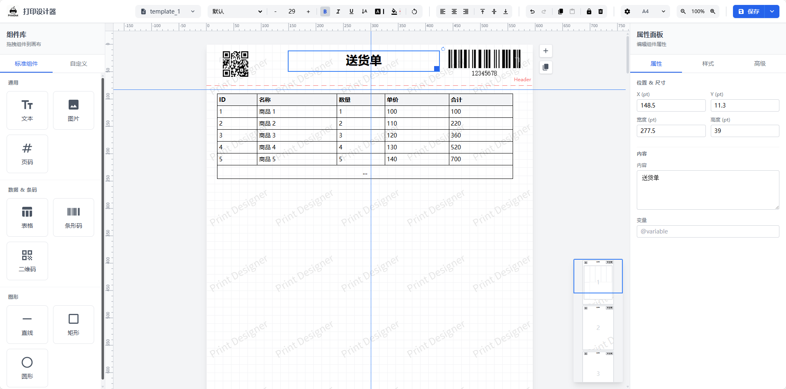
</p>

<p align="center"><sub>設計器主介面  ·  畫布視圖 / 屬性面板 / 圖層面板</sub></p>

<table width="100%">
  <tr>
    <td align="center" width="20%"><b>首屏體積 −65%</b></td>
    <td align="center" width="20%"><b>ES 包體積 300 KB</b></td>
    <td align="center" width="20%"><b>單頁渲染 80 ms</b></td>
    <td align="center" width="20%"><b>內置語言 6 種</b></td>
    <td align="center" width="20%"><b>標籤指令集 4 種</b></td>
  </tr>
  <tr>
    <td align="center" valign="top"><sub>移除 6 個第三方大包，首屏加載更輕</sub></td>
    <td align="center" valign="top"><sub>Web Components 構建產物，接入成本更低</sub></td>
    <td align="center" valign="top"><sub>自研渲染引擎，較舊版提速約 73%</sub></td>
    <td align="center" valign="top"><sub>按瀏覽器環境自動適配，也可 API 手動設置</sub></td>
    <td align="center" valign="top"><sub>支持 TSPL / ZPL / ESC-POS / CPCL</sub></td>
  </tr>
</table>

<p align="center"><sub>拖拽排版  →  綁定變量  →  預覽校驗  →  瀏覽器 / 客戶端 / 標籤機輸出</sub></p>

---

## 核心能力

<p align="center"><b>AI 助手 · 用自然語言直接生成與修改模板</b><br/><sub>內置自然語言對話面板，描述需求即可生成發票、發貨單、面單等模板，支持多輪修改與圖片參考輸入；生成結果先以變更預覽呈現，確認後一鍵應用到畫布。兼容 OpenAI 協議接口，可接入自建或第三方模型服務，支持多模型配置與高級採樣參數。</sub></p>

<table width="100%">
  <tr>
    <td align="center" width="33%"><b>可視化設計</b></td>
    <td align="center" width="34%"><b>智能分頁</b></td>
    <td align="center" width="33%"><b>跨框架支持</b></td>
  </tr>
  <tr>
    <td align="center" valign="top"><sub>拖拽完成排版，支持文本 / 圖片 / 表格 / 條碼 / 二維碼 / 形狀，標尺、網格與輔助對齊讓版式對齊不再靠目測。</sub></td>
    <td align="center" valign="top"><sub>自動處理長表格分頁，表頭 / 表尾可重複，無需手寫複雜邏輯，所見即所得。</sub></td>
    <td align="center" valign="top"><sub>基於 Web Components，零依賴適配 Vue / React / Angular / 原生 HTML，支持 Vue 2。</sub></td>
  </tr>
  <tr>
    <td align="center" width="33%"><b>企業級功能</b></td>
    <td align="center" width="34%"><b>打印與標籤</b></td>
    <td align="center" width="33%"><b>國際化</b></td>
  </tr>
  <tr>
    <td align="center" valign="top"><sub>自定義紙張、API 數據對接、模板導入導出，打印機 / 份數 / 單雙面 / DPI 可控。</sub></td>
    <td align="center" valign="top"><sub>瀏覽器打印、PDF 與圖片導出、靜默 / 雲打印，模板轉原生指令經系統隊列 RAW 直出，條碼二維碼保持矢量銳度。</sub></td>
    <td align="center" valign="top"><sub>中文簡繁、英、日、韓、德 6 種語言，按瀏覽器環境自動檢測，也可通過 API 手動設置。</sub></td>
  </tr>
</table>

## 介面預覽

<table width="100%">
  <tr>
    <td align="center" width="50%">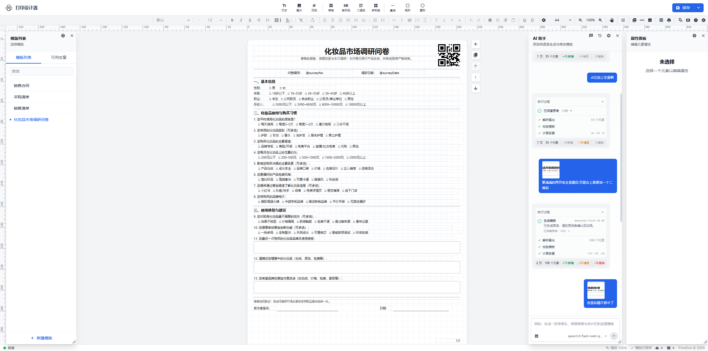</td>
    <td align="center" width="50%">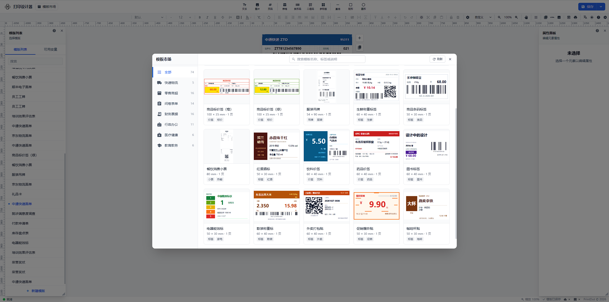</td>
  </tr>
  <tr>
    <td align="center"><b>AI 助手 · 自然語言生成模板</b></td>
    <td align="center"><b>模板市場</b></td>
  </tr>
</table>

<table width="100%">
  <tr>
    <td align="center" width="25%">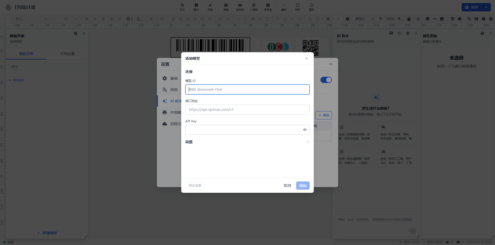</td>
    <td align="center" width="25%">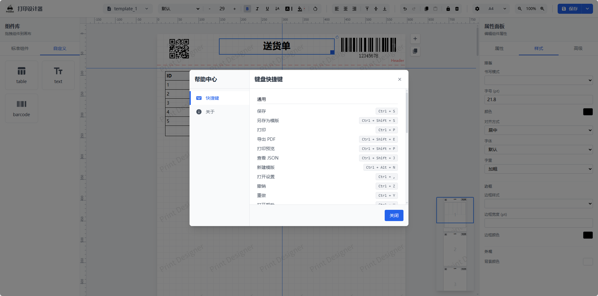</td>
    <td align="center" width="25%">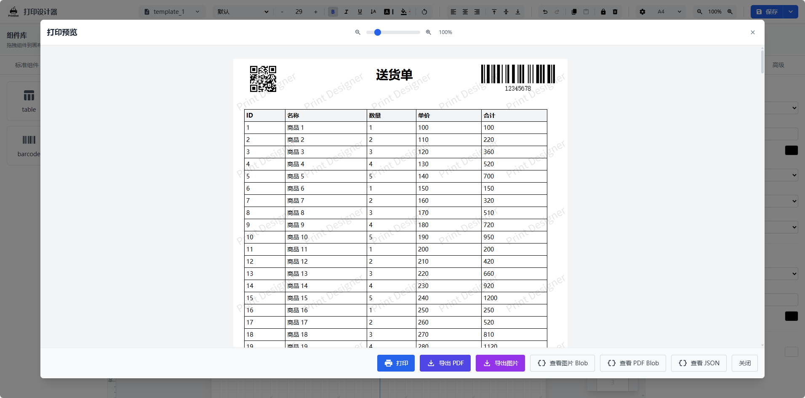</td>
    <td align="center" width="25%"></td>
  </tr>
  <tr>
    <td align="center"><b>AI 助手 · 模型接入配置</b></td>
    <td align="center"><b>快捷鍵說明</b></td>
    <td align="center"><b>打印預覽</b></td>
    <td align="center"><b>社群交流 &middot; QQ 群 1038069636</b></td>
  </tr>
</table>

## 打印與導出

<table width="100%" style="width: 100%;">
  <tr>
    <td align="center" width="25%" style="width: 25%;"><b>瀏覽器打印</b></td>
    <td align="center" width="25%" style="width: 25%;"><b>導出</b></td>
    <td align="center" width="25%" style="width: 25%;"><b>靜默 / 雲打印</b></td>
    <td align="center" width="25%" style="width: 25%;"><b>標籤 RAW 直出</b></td>
  </tr>
  <tr>
    <td align="center" valign="top"><sub>原生預覽與打印，支持打印機 / 份數 / 單雙面 / DPI 參數控制</sub></td>
    <td align="center" valign="top"><sub>生成 PDF、圖片（拼接 / 分片）、HTML 與 Blob，可自定義文件名</sub></td>
    <td align="center" valign="top"><sub>靜默打印無彈窗直打，雲打印遠程任務下發，由本地客戶端執行</sub></td>
    <td align="center" valign="top"><sub>模板轉原生指令，經系統打印隊列 RAW 直出，支持批量與連續紙</sub></td>
  </tr>
</table>

## 配套打印客戶端（PrintDot Client）

PrintDot Client 是本項目的配套桌面客戶端，用於連接本地打印機並執行靜默打印任務。安裝後，即可在瀏覽器中直接發起打印而無需彈窗確認。它提供服務控制、連接配置、打印記錄、版本更新與打印預覽等功能，幫助你在本地快速完成打印閉環。

- **支持平台**：Windows / macOS / Linux
- **關鍵能力**：自動發現並識別設備、穩定連接維護與轉發隊列、輕量後台運行、打印任務記錄與版本更新提示
- **下載地址**：[https://printdot.cc/zh-tw/client](https://printdot.cc/zh-tw/client)

<table width="100%">
  <tr>
    <td align="center" width="20%">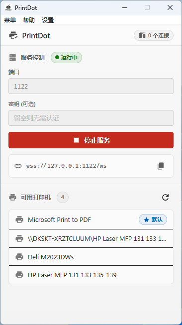</td>
    <td align="center" width="20%">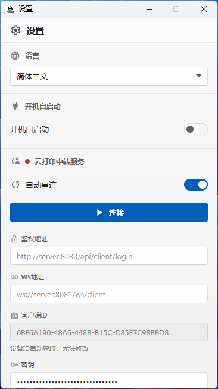</td>
    <td align="center" width="20%">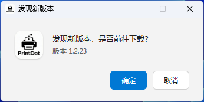</td>
    <td align="center" width="20%">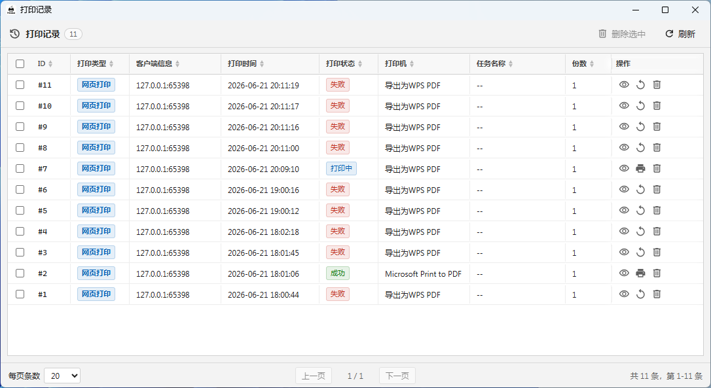</td>
    <td align="center" width="20%"></td>
  </tr>
  <tr>
    <td align="center"><b>主介面 · 服務控制與可用打印機</b></td>
    <td align="center"><b>設置 · 雲打印中轉與連接配置</b></td>
    <td align="center"><b>版本更新 · 一鍵檢測最新客戶端</b></td>
    <td align="center"><b>打印記錄 · 任務狀態與重試</b></td>
    <td align="center"><b>打印預覽 · 本地客戶端實時預覽</b></td>
  </tr>
</table>

### 標籤打印（RAW 指令直出）

熱敏 / 熱轉印標籤機（TSC、佳博、斑馬、漢印、得力、芯燁等）是指令集打印機，用 PDF 只能整頁柵格化：出標慢、條碼識別率下降、自定義紙張易錯位。客戶端提供獨立的標籤通道：解析模板 JSON 生成原生指令，以 RAW 投遞到系統打印隊列，驅動原樣透傳。

<table width="100%">
  <tr>
    <td align="center" width="20%"><b>四種指令集</b></td>
    <td align="center" width="20%"><b>元素完整還原</b></td>
    <td align="center" width="20%"><b>打印參數可控</b></td>
    <td align="center" width="20%"><b>批量與多頁</b></td>
    <td align="center" width="20%"><b>打印記錄</b></td>
  </tr>
  <tr>
    <td align="center" valign="top"><sub>TSPL / ZPL / ESC-POS / CPCL，默認按打印機名與驅動名自動推斷，識別不到時可顯式指定。</sub></td>
    <td align="center" valign="top"><sub>文本、條碼、二維碼、表格（合併、表頭表尾）、圖片（抖動黑白）、圖形與旋轉。</sub></td>
    <td align="center" valign="top"><sub>標籤紙寬高（高度 0 為連續紙）、DPI、速度、濃度、間隙 / 黑標 / 偏移、位圖或機內字庫。</sub></td>
    <td align="center" valign="top"><sub>模板一頁即一張標籤；<code>labels[]</code> 可整批提交，每條獨立設置份數，標籤間可配間隔。</sub></td>
    <td align="center" valign="top"><sub>每次標籤打印都會記入客戶端打印記錄，可查看打印機、份數、狀態與時間，失敗任務可重試。</sub></td>
  </tr>
</table>

#### 兩條使用路徑

- 業務端發送 `print_label` 消息，把設計器導出的模板 JSON 原樣轉發即可，無需二次加工；
- 在客戶端打印預覽窗口勾選「標籤打印」即可本地出標（需設計器預覽模式為 JSON）；選中標籤機時會自動識別指令集並勾選，識別結果可隨時手動推翻。

#### 打印效果一致性比對

下圖為同一張 60 × 40 mm 倉庫標籤的三種呈現：設計器導出的原始效果、Zebra 官方 Labelary 服務按 ZPL 指令解析出的固件模擬結果，以及客戶端本地按同一批指令重繪的結果。右下角將三者分別以紅、黃、藍三層疊加，重合區域呈深紫灰，可據此檢查文本位置、字號與條碼模塊是否對齊。

<p align="center">
  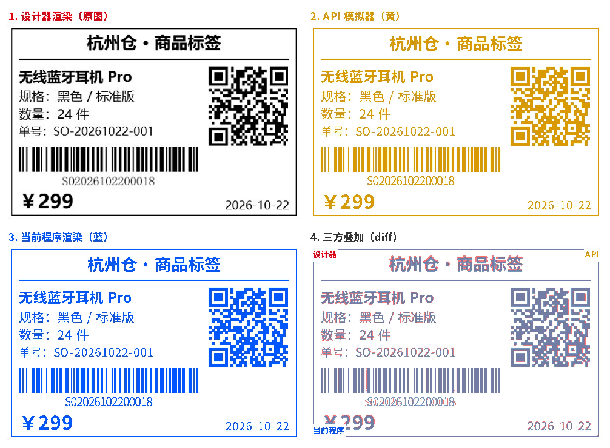
</p>

<p align="center"><b>四路對照：設計器原圖 / 廠商 API 模擬 / 客戶端指令渲染 / 三方疊加</b></p>

<table width="100%">
  <tr>
    <td align="center" width="25%">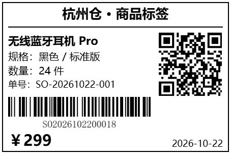</td>
    <td align="center" width="25%"></td>
    <td align="center" width="25%"></td>
    <td align="center" width="25%">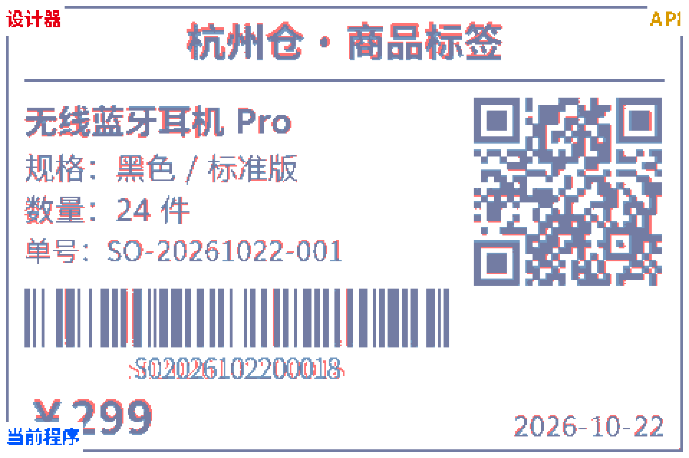</td>
  </tr>
  <tr>
    <td align="center"><b>設計器原圖</b></td>
    <td align="center"><b>廠商 API 模擬</b></td>
    <td align="center"><b>客戶端指令渲染</b></td>
    <td align="center"><b>三方疊加（diff）</b></td>
  </tr>
</table>

> 說明：標籤紙只能打印黑白，彩色圖片會自動轉成黑白效果。頁碼、水印、漸變和陰影在標籤上不會顯示。使用 ESC/POS 指令集的打印機需支持 page mode。文字排版在不同電腦上保持一致，位置誤差不超過 0.06 mm（203 dpi 下）。

---

## 集成示例

基於 **Vue 3 + Element Plus** 的完整集成示例，演示如何在實際業務系統中嵌入打印設計器。

<table width="100%">
  <tr>
    <td align="center" width="33%"></td>
    <td align="center" width="34%"></td>
    <td align="center" width="33%"></td>
  </tr>
  <tr>
    <td align="center"><b>參數調試</b></td>
    <td align="center"><b>設計器</b></td>
    <td align="center"><b>暗色模式</b></td>
  </tr>
</table>

- **項目地址**：[https://github.com/0ldFive/vue-designer-sample](https://github.com/0ldFive/vue-designer-sample)
- **在線演示**：[https://0ldfive.github.io/vue-designer-sample/#/designer](https://0ldfive.github.io/vue-designer-sample/#/designer)
- **技術棧**：Vue 3, TypeScript, Element Plus, Vite

## 快速開始

### 方式一：npm 組件（Web Components）

適合任何技術棧（Vue / React / Angular / 原生）。Web Components 方式**支持 Vue 2**（作為自定義元素使用），無需 Vue 2 組件適配。詳細參數、CRUD 與 JSON 示例請查看：[Web Components API 用戶手冊](https://printdot.cc/zh-tw/docs)。

```bash
npm i vue-print-designer
# 或
pnpm add vue-print-designer
# 或
yarn add vue-print-designer
```

<details>
<summary><b>展開：Vue 3 / Vite 接入示例</b>（引入 · 初始化 · 打印導出 · 事件監聽）</summary>

**1) 在 Vue 3 / Vite 中使用**

```ts
// main.ts
import "vue-print-designer";
import "vue-print-designer/style.css";
```

```vue
<template>
  <print-designer id="designer"></print-designer>
</template>
```

**2) 初始化與調用分離（Vue 3 選項式 API）**

設計器頁面（初始化與編輯）：

```vue
<script lang="ts">
export default {
  mounted() {
    const el = this.$refs.designerRef as any;
    el.setBranding({ title: "業務打印設計器", showLogo: true });
    el.setTheme("light");
    el.loadTemplateData(/* 從你的 API 獲取的數據 */);
    el.setVariables({ orderNo: "A001" }, { merge: true });
  },
};
</script>

<template>
  <print-designer ref="designerRef"></print-designer>
</template>
```

業務頁面（打印 / 導出調用）：

```ts
const el = document.querySelector("print-designer") as any;

// 打印
await el.print({ mode: "browser" });

// 導出 PDF / 圖片 / HTML / Blob
await el.export({ type: "pdf", filename: "order-20240223.pdf" });
await el.export({ type: "html", filename: "order-20240223.html" });
const pdfBlob = await el.export({ type: "pdfBlob" });
```

**3) 事件監聽**

```ts
el.addEventListener("ready", () => {});
el.addEventListener("printed", (e) => {});
el.addEventListener("exported", (e) => {
  const blob = e.detail?.blob;
});
el.addEventListener("error", (e) => {
  console.error(e.detail?.scope, e.detail?.error);
});
```

</details>

### 方式二：下載源碼自行改造與集成 API

適合有深度定制需求的團隊。環境要求：

- Node.js >= 16.0.0
- npm >= 7.0.0 或 yarn / pnpm

建議接入點：

- 模板 CRUD：`useTemplateStore`（可替換為接口讀寫）
- 自定義元素 CRUD：`useDesignerStore` 中的 `customElements`
- 變量與模板數據：組件實例方法 `setVariables` / `loadTemplateData`

自定義元素擴展請查看：[自定義元素擴展指南](https://printdot.cc/zh-tw/docs)。

## 國際化

項目內置 6 種語言，默認根據瀏覽器語言自動檢測，也可通過 API 手動設置：

<p align="center">
  <kbd>中文簡體 zh</kbd> <kbd>中文繁體 zh-Hant</kbd> <kbd>English en</kbd> <kbd>日本語 ja</kbd> <kbd>한국어 ko</kbd> <kbd>Deutsch de</kbd>
</p>

---

## License

AGPL-3.0-only

品牌與 Logo 使用請遵循 [TRADEMARKS.md](https://github.com/0ldFive/Vue-Print-Designer/blob/master/TRADEMARKS.md)。如需移除或替換品牌標識，請參考 [COMMERCIAL_LICENSE.md](https://github.com/0ldFive/Vue-Print-Designer/blob/master/COMMERCIAL_LICENSE.md)。
